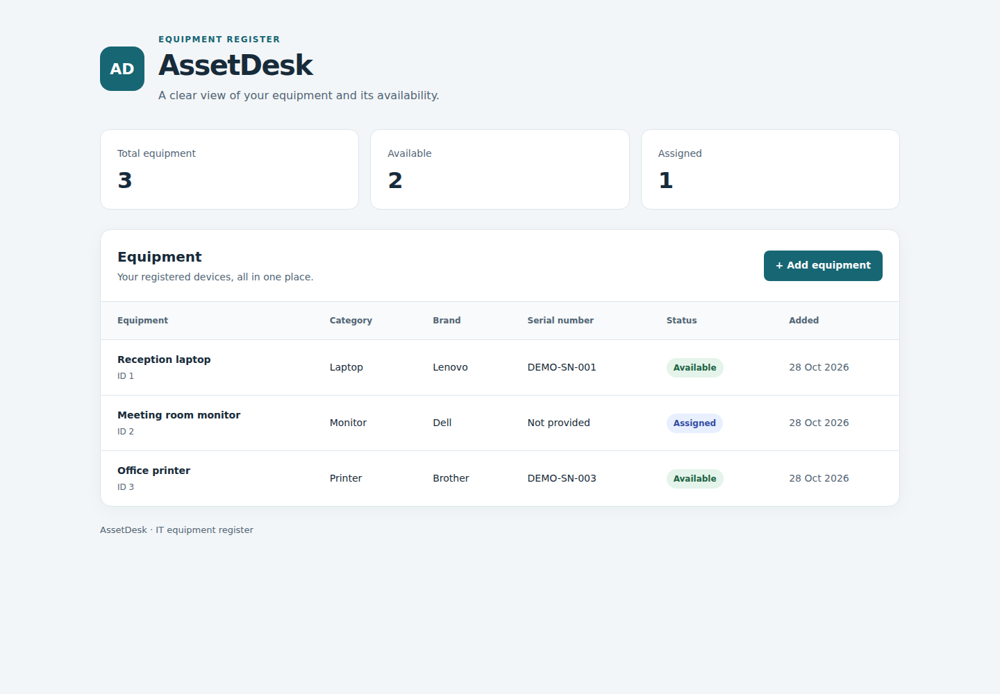

# AssetDesk

A small IT equipment register built with Python, FastAPI, SQLAlchemy,
SQLite and React.

Add equipment through a form, view saved records and check how many items
are available or assigned. Each record includes an alias, category, brand,
optional serial number, status and creation date.



## Running locally

The project uses Python 3.14 and Node.js 24 with npm. The commands below
use uv to manage the Python environment. Development has been carried out
on Ubuntu and macOS.

### First setup

Clone the repository:

```bash
git clone https://github.com/mrdotgr/assetdesk.git
cd assetdesk
```

If you already have a copy, open its existing folder instead of cloning
again. Run the following commands from the project root, where `app/`,
`frontend/` and `requirements.txt` are located.

Create the Python environment if `.venv` does not already exist:

```bash
uv venv --python 3.14 .venv
```

Install the backend dependencies:

```bash
uv pip install --python .venv/bin/python -r requirements.txt
```

This installs FastAPI, Pydantic, SQLAlchemy, Uvicorn and the other Python
packages listed in `requirements.txt`.

Install the frontend dependencies:

```bash
cd frontend
npm ci
cd ..
```

This installs React, Vite and the other frontend packages using the versions
recorded in `package-lock.json`.

### Start the app

Keep two terminals open, both starting from the project root.

In the first terminal, start the API:

```bash
source .venv/bin/activate
python -m uvicorn app.main:app --reload
```

In the second terminal, start the interface:

```bash
cd frontend
npm run dev
```

Open [AssetDesk](http://127.0.0.1:5173). The
[API documentation](http://127.0.0.1:8000/docs) is available separately.
Both servers must stay running while using the app.

A fresh database starts empty. Use **Add equipment** to save the first
record. Stop each server with `Ctrl+C`.

For later runs, use only the start commands. Repeat dependency installation
when `requirements.txt` or the frontend dependency files change.

## API

| Method | Path | Purpose |
| --- | --- | --- |
| GET | `/health` | Check that the API responds. |
| GET | `/assets` | List saved equipment in ID order. |
| POST | `/assets` | Create an equipment record. |

Alias, category and brand are required nonblank text. Serial numbers are
optional and must be unique when provided. Status accepts `available` or
`assigned` and defaults to `available`.

A successful create request returns `201` with the saved record, including
its generated ID and timestamp. Invalid input returns `422`; a duplicate
serial number returns `409`.

## Database

AssetDesk uses SQLite. There is no separate database server to install or
start. The backend creates `assetdesk.db` in the project root and creates
missing tables at startup.

Records remain between runs. Creation timestamps use `Europe/Athens` with
the applicable UTC offset. Database files are excluded from Git, so a new
clone does not include records from another computer.

## Checks

From the project root, with the Python environment active:

```bash
python -m pytest -v
```

From `frontend/`:

```bash
npm run lint
npm run build
```

The Python tests cover input validation. The frontend commands check source
issues and produce a build in `frontend/dist/`. Building does not publish
the app online.

## Project notes

This version supports creating and listing equipment. Editing, deleting
and user accounts are not included yet. Assigned is a status label; it
does not record who has the equipment.

The `learning/` folder contains standalone Python and database exercises.
[Python foundations](docs/python-foundations.md) explains the backend
concepts, and the [frontend guide](docs/frontend-guide.md) covers the
interface and its API requests.

All sample equipment data, including the screenshot, is fictional.
