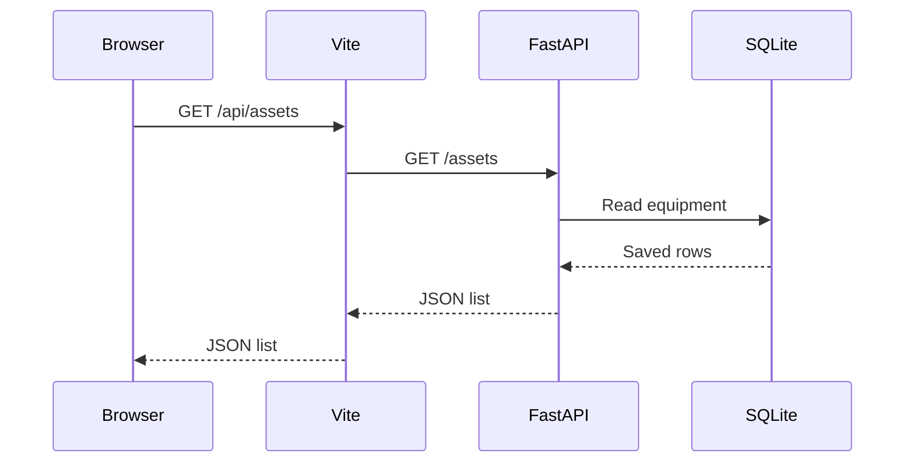

# AssetDesk frontend guide

This guide follows the working equipment list and add-equipment form. Read
one section at a time and compare it with the relevant part of `App.jsx`.

## 1. What the interface does

The browser displays equipment returned by the existing API. It can also send
details for a new record. Python remains responsible for validation and database
storage; the browser does not open the SQLite file directly.



The current interface creates and lists records. It does not edit or delete
them. Selecting Assigned when creating a record sets a status label; it does
not choose an employee or create an assignment history.

## 2. The tools have different jobs

| Tool or language | Job here |
| --- | --- |
| HTML | Gives the browser a page with a root container. |
| CSS | Sets colours, spacing, layout and responsive behavior. |
| JavaScript | Loads data, handles input and responds to clicks. |
| React | Uses components and state to keep the displayed interface in sync with data. |
| Node.js | Runs development tools on the computer. |
| npm | Installs JavaScript packages and runs project scripts. |
| Vite | Serves the frontend during development and produces a build. |

The starter command created a project structure. The AssetDesk components,
equipment form, request handling and styles live in the source files and can
be changed independently of that starter setup.

## 3. Which file does what?

| File | Responsibility |
| --- | --- |
| `index.html` | Loads `src/main.jsx` and provides `<div id="root">`. |
| `src/main.jsx` | Starts React inside that root and displays `<App />`. |
| `src/App.jsx` | Defines the App and AssetForm components and their behavior. |
| `src/App.css` | Styles the register, table, form, buttons and messages. |
| `src/index.css` | Defines shared colours, typography and basic page rules. |
| `vite.config.js` | Configures port 5173 and forwards API requests to port 8000. |
| `package.json` | Lists dependencies and scripts such as dev, lint and build. |
| `package-lock.json` | Records the resolved dependency versions. |

`node_modules` contains downloaded packages. It is not where application code
should be edited, and it is not committed. Each computer installs its own copy.

## 4. A React component is a function describing part of the screen

For example:

```jsx
function Welcome() {
  return <h1>AssetDesk</h1>;
}
```

The returned expression describes a heading. This HTML-like notation inside
JavaScript is called JSX. React can display the component as `<Welcome />`.
In this project, `App` describes the overall page and `AssetForm` describes
the form. They are JavaScript functions, not Python classes.

In JSX, `className="summary-card"` assigns a CSS styling label. A CSS rule
named `.summary-card` applies to those elements. This use of the word class
has a different meaning from `class Asset` in Python.

## 5. State remembers values and updates the screen

```jsx
const [assets, setAssets] = useState([]);
```

Read this as: "Remember the equipment list, starting with an empty list."

- `assets` is the current list.
- `setAssets(...)` requests a new list and a new render of the component.
- `[]` is the starting value.

Other state values remember whether a request is loading, whether the form is
open, the form's typed values, and any error or success message.

The list in browser memory is temporary. Refreshing the page recreates it by
asking the backend for the persistent records again.

## 6. Loading equipment

`useEffect` starts the initial request after the component appears.

```jsx
const response = await fetch("/api/assets");
const data = await response.json();
setAssets(data);
```

Read these steps as:

1. Ask the API for the equipment and wait for the response.
2. Read its JSON body as JavaScript values.
3. Store that list in React state so the table can display it.

`response.ok` indicates a successful HTTP status. Network failures and HTTP
errors are handled separately in the code. `AbortController` lets cleanup
cancel a request when the component is removed. An intentionally cancelled
request should not show a connection-error message.

`StrictMode` in `main.jsx` enables development checks. It may run an effect's
setup and cleanup an extra time during development. The request cleanup handles
that case; the form's POST runs on submit, not in an effect.

## 7. Turning equipment into rows and counts

```jsx
assets.map((asset) => <tr key={asset.id}>...</tr>)
```

`map` produces one row for each object in the list. The key lets React identify
which record a row belongs to. A field is read with a dot: `asset.name_alias`.

```jsx
assets.filter((asset) => asset.status === "available").length
```

`filter` selects the objects whose status is available. `length` counts the
selected objects. These counts are calculated from the existing list; no extra
database query is needed.

```jsx
asset.serial_number ?? "Not provided"
```

This displays a fallback when the serial is null or undefined. The display
does not change the stored value.

## 8. Typing in the form

`form` is an object holding five fields. Each input has a matching `name`.

```jsx
const { name, value } = event.target;
setForm((current) => ({ ...current, [name]: value }));
```

For example, typing Lenovo in the brand input gives `name` the value `brand`
and `value` the text `Lenovo`. The update makes a new object containing the old
fields, then replaces the brand field. The spread syntax `...current` copies
those existing fields; `[name]` selects the property to update.

Inputs use React state as their value and update it through `onChange`. These
are called controlled inputs.

## 9. Saving the form

When Save equipment is pressed, `handleSubmit`:

1. Calls `preventDefault()` so the browser does not navigate away.
2. Trims surrounding spaces and turns an empty optional serial into `null`.
3. Checks that required text is not whitespace only.
4. Disables the form while the request is pending.
5. Sends a POST with a JSON body to `/api/assets`.
6. Handles a failed response or reads the saved record from a successful one.

The browser's required fields are a convenience. The backend still validates
every request independently, including requests made outside this interface.

A 409 response displays a duplicate-serial message. A 422 response displays a
validation message. Failed requests keep the entered values so they can be
corrected. A connection interruption can leave the save result uncertain;
refresh the list before retrying in that case.

## 10. Passing a result back to the page

```jsx
<AssetForm onSaved={handleSaved} onCancel={closeForm} />
```

The parent App passes two functions to the form. These values passed to a
component are called props. The form calls `onSaved(savedAsset)` after the
backend confirms a successful save.

```jsx
setAssets((current) => [...current, asset]);
```

The parent creates an updated list containing the old records and the new one.
React displays it, the counts update, and the form closes. The frontend uses
the backend's generated ID rather than inventing one.

`useRef` is used for keyboard focus and to block a second submission while
one is in progress. Unlike a state update, changing a ref does not itself
request a new render.

## 11. Where CSS fits

`App.jsx` selects which elements appear. CSS controls their presentation.

- `padding`: space inside an element.
- `margin`: space around an element.
- `display: grid`: arrange cards or fields into columns.
- `border-radius`: round the corners.
- `@media`: adjust styles for a smaller browser width.
- `overflow-x: auto`: allow a wide table to scroll inside its container.

The header's AD mark is text styled by CSS. The browser-tab icon is a separate
SVG file referenced by `index.html`.

## 12. A short practical review

Create one fictional device, then follow it through the code:

1. Find the input's `name` and its value in `form`.
2. Find where the POST body is constructed.
3. Find the corresponding `create_asset` function in `app/main.py`.
4. Find the saved record in the POST response.
5. Find where `handleSaved` appends it to the list.
6. Refresh and see that the next GET loads it from the database.

For a small CSS exercise, change the gap between summary cards, save, and
observe the result. Restore it before committing if it was only an experiment.

Git records source-code changes. It does not upload the ignored SQLite database,
install packages on another computer, or host a running web application.
