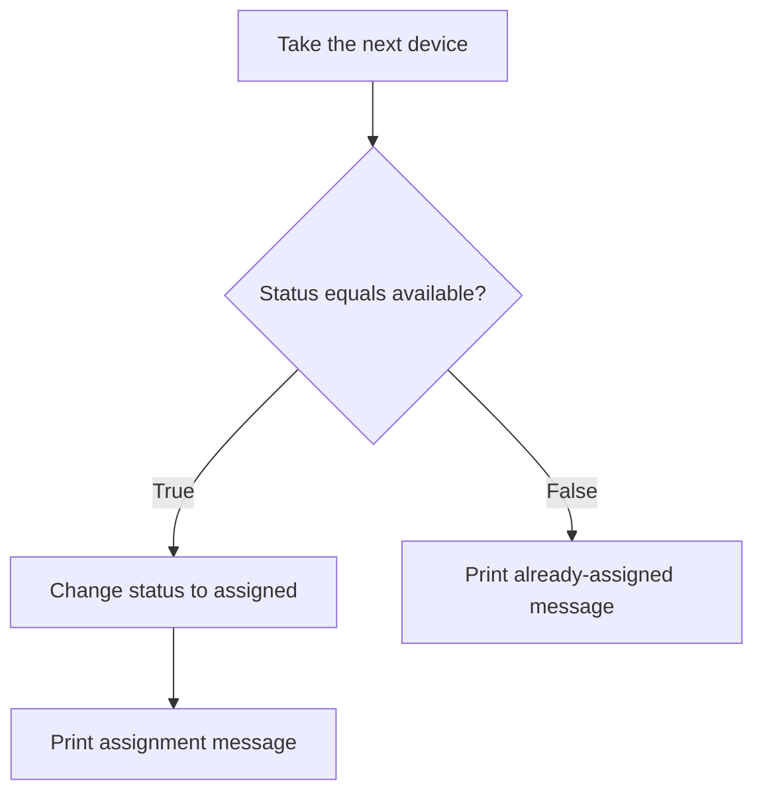
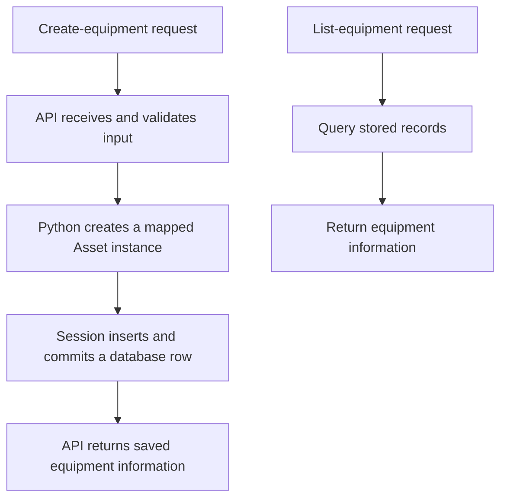

# AssetDesk — Python Foundations

A practical learning handbook: from one equipment dictionary to classes, methods and the first database concepts.

This is an organized course reference, not a transcript. The Python lessons build on one another. The database appendix is a reference for the next stage, not a claim that the API is implemented or that every database concept has been mastered.

## How to use this handbook

Read one lesson, predict its output, run it, and change one detail. Then try a similar example without copying the whole solution. Revisit a small example at the next session.

Examples marked **standalone** can run independently. Short fragments use definitions from the surrounding lesson. Alternative versions of a function or class are alternatives: do not paste every version into one file and expect them all to stay active. A later definition under the same name replaces the earlier one.

Use the **BEFORE → CHANGE → AFTER** labels to spot changes that are easy to overlook.

### Navigation

1. [Choose the right tool](#1-choose-the-right-tool)
2. [Variables and dictionaries](#2-variables-and-dictionaries)
3. [Functions and the dictionary they receive](#3-functions-and-the-dictionary-they-receive)
4. [Parameters and defaults](#4-parameters-and-defaults)
5. [Return versus print](#5-return-versus-print)
6. [Create a dictionary with a function](#6-create-a-dictionary-with-a-function)
7. [Lists and loops](#7-lists-and-loops)
8. [Conditions](#8-conditions)
9. [Classes and instances](#9-classes-and-instances)
10. [Initialization and self](#10-initialization-and-self)
11. [Methods](#11-methods)
12. [Lists of instances](#12-lists-of-instances)
13. [Earlier values and current attributes](#13-earlier-values-and-current-attributes)
14. [Complete class exercise](#14-complete-class-exercise)
15. [Common mistakes and syntax](#15-common-mistakes-and-syntax)
16. [Exercises](#16-exercises)
17. [Answers](#17-answers)
18. [Bridge to database storage](#18-bridge-to-database-storage)
19. [Original ORM exercise explained](#19-original-orm-exercise-explained)
20. [Run and commit a checkpoint](#20-run-and-commit-a-checkpoint)

## 1. Choose the right tool

Start with the task in ordinary English, then choose a tool.

| I need to… | Tool | Example |
|---|---|---|
| Refer to a value | Variable | `name = "Demo laptop"` |
| Group labeled details | Dictionary | `{"name": "Demo laptop", "status": "available"}` |
| Collect several items | List | `[monitor, printer]` |
| Name and reuse an action | Function | `change_status(printer, "assigned")` |
| Repeat an action for each item | Loop | `for device in devices:` |
| Choose whether an action happens | Condition | `if device["status"] == "available":` |
| Define an equipment type with data and related actions | Class | `class Asset:` |
| Represent a particular item of that type | Instance | `printer = Asset("Demo printer")` |
| Perform an action on that instance | Method call | `printer.make_available()` |
| Keep records after the process ends | Persistent storage | SQLite database file |

A class is not mandatory for every program. Dictionaries and functions are a valid approach. Classes become useful when a named type and its associated behaviour help organize the program, or a library such as an ORM uses classes for mapping data.

## 2. Variables and dictionaries

### One value

```python
# Give a text value a name so we can use it later.
name = "Demo laptop"
print(name)
```

Output: `Demo laptop`.

`name` is a variable name we chose. `"Demo laptop"` is a string: a text value. The equals sign assigns the value on the right to the target on the left.

### Several labeled details — standalone

```python
# BEFORE: group the details of one device in a dictionary.
monitor = {
    "name": "Demo monitor",
    "status": "available",
}

# Read the value stored under the status key.
print(monitor["status"])

# CHANGE: replace only the status value.
monitor["status"] = "assigned"

# AFTER: the name is unchanged, but the status is different.
print(monitor["name"])
print(monitor["status"])
```

Expected output:

```text
available
Demo monitor
assigned
```

| Part | Meaning |
|---|---|
| `monitor` | Our chosen variable referring to the dictionary |
| `"name"`, `"status"` | Text keys chosen for this dictionary |
| `"Demo monitor"`, `"available"` | Values stored under those keys |
| `{}` | Dictionary syntax in this example |
| `monitor["status"]` | Access the entry under the status key |

These values currently live in the Python process's memory. Nothing here writes a database or file.

## 3. Functions and the dictionary they receive

A function gives instructions a reusable name. Defining it does not execute its body. Calling it does.

### Standalone example

```python
def assign_device(device):
    # Change the dictionary supplied to this function.
    device["status"] = "assigned"


# BEFORE: two separate dictionaries.
monitor = {"name": "Demo monitor", "status": "available"}
keyboard = {"name": "Demo keyboard", "status": "available"}

# CHANGE: supply only the keyboard to the function.
assign_device(keyboard)

# AFTER: the monitor was not changed.
print(monitor["status"])
print(keyboard["status"])
```

Output:

```text
available
assigned
```

During `assign_device(keyboard)`, the parameter `device` refers to the same dictionary as `keyboard`. It is not a copy and not a second device. The instruction inside the function changes that supplied dictionary.

| Place | Name used for the dictionary |
|---|---|
| Outside the function | `keyboard` |
| Inside this call | `device` |

**Parameter:** a name in the function definition, such as `device`.

**Argument:** a value supplied when calling it, such as the dictionary referred to by `keyboard`.

```python
def make_available(device):
    # This action always chooses the same new status.
    device["status"] = "available"
```

Call that action with `make_available(keyboard)` when you want to make the keyboard available again.

## 4. Parameters and defaults

Instead of two functions that choose fixed statuses, let the caller choose the status:

```python
def change_status(device, new_status):
    # Put the caller's chosen value into the supplied dictionary.
    device["status"] = new_status
```

For `change_status(monitor, "assigned")`:

| Supplied argument | Parameter receiving it |
|---|---|
| `monitor` dictionary | `device` |
| `"assigned"` | `new_status` |

Read the instruction as: “In this device, store this new status.”

We add parameters when the caller needs to supply information. A parameter list is not a list of every piece of information the program will hold.

### Default argument

```python
def create_device(name, status="available"):
    # Use the supplied status, or available when it was omitted.
    return {"name": name, "status": status}
```

| Call | Starting status |
|---|---|
| `create_device("Demo mouse")` | `"available"` |
| `create_device("Demo laptop", "assigned")` | `"assigned"` |

The default is a starting value, not a permanent restriction. Later code can change the stored status.

## 5. Return versus print

`return` gives a result back to the calling code and ends that function call. `print` displays information in the terminal. Returning a result does not automatically print it.

### Standalone example

```python
def get_status(device):
    # Return information without changing the dictionary.
    return device["status"]


def get_name(device):
    # Return the name so other code can use it.
    return device["name"]


monitor = {"name": "Demo monitor", "status": "available"}

# Keep the returned values, then decide to display them.
current_status = get_status(monitor)
monitor_name = get_name(monitor)
print(current_status)
print(monitor_name)
```

Output:

```text
available
Demo monitor
```

Trace `current_status = get_status(monitor)`:

1. Supply the monitor dictionary.
2. Retrieve its status inside the function.
3. Return the string `"available"`.
4. Assign that returned string to `current_status`.

A function with no explicit return value returns `None`. `None` represents the absence of a value here. Our dictionary-changing functions work by modifying the supplied dictionary; they do not need to return a status to perform that modification.

## 6. Create a dictionary with a function

### Standalone example

```python
def create_device(name, status="available"):
    # Build a fresh dictionary each time the function is called.
    return {
        "name": name,
        "status": status,
    }


mouse = create_device("Demo mouse")
laptop = create_device("Demo laptop", "assigned")

print(mouse["status"])
print(laptop["status"])
```

Output:

```text
available
assigned
```

In `"name": name`, the quoted text on the left is a dictionary key. The unquoted name on the right is the parameter whose current value we store.

For `create_device("Demo mouse")`, that entry becomes `"name": "Demo mouse"`.

Each call creates a new dictionary because the function executes a new dictionary expression each time. We have centralized the instructions for constructing a consistent record.

## 7. Lists and loops

A list groups items in order. Positions start at zero. A list can contain dictionaries or class instances; choose access syntax based on the actual item type.

### Standalone example

```python
# BEFORE: create two dictionaries and group the existing dictionaries.
monitor = {"name": "Demo monitor", "status": "available"}
printer = {"name": "Demo printer", "status": "available"}
devices = [monitor, printer]

# CHANGE: item 1 is the printer, because positions start at zero.
devices[1]["status"] = "assigned"

# AFTER: visit each dictionary and display its current status.
for device in devices:
    print(device["status"])
```

Output:

```text
available
assigned
```

| Expression | Result |
|---|---|
| `devices[0]` | Monitor dictionary |
| `devices[1]` | Printer dictionary |
| `devices[1]["name"]` | `"Demo printer"` |

The list holds references to the existing dictionaries; it does not automatically duplicate them.

Read `for device in devices:` as: “Visit each item, and use the name `device` to refer to the current item while running the indented block.” We chose the loop variable name. The loop does not create a new device each round.

## 8. Conditions

Use a condition when an action should happen only in a particular situation.

| Symbol | Job |
|---|---|
| `=` | Assign a value |
| `==` | Compare values for equality |

### Standalone example

```python
def change_status(device, new_status):
    # Reuse the same update instruction for different dictionaries.
    device["status"] = new_status


monitor = {"name": "Demo monitor", "status": "available"}
printer = {"name": "Demo printer", "status": "assigned"}
devices = [monitor, printer]

# Check each device before deciding which branch to run.
for device in devices:
    if device["status"] == "available":
        change_status(device, "assigned")
        print(device["name"], "was assigned")
    else:
        print(device["name"], "was already assigned")
```

Output:

```text
Demo monitor was assigned
Demo printer was already assigned
```



Indentation identifies which instructions belong to the loop and which belong to each condition branch. Both indented lines beneath `if` run only when the condition is true.

To reverse the action:

```python
# Make assigned devices available; leave the others unchanged.
for device in devices:
    if device["status"] == "assigned":
        change_status(device, "available")
```

## 9. Classes and instances

A class defines a type of object. An instance is a particular object created from that class. A method is a function defined in the class; an ordinary instance method receives the instance through `self`.

Python dictionaries and lists are objects too. “Object” is a broad word; “Asset instance” identifies the particular type we mean.

### Standalone example

```python
class Asset:
    def __init__(self, name, status="available"):
        # Keep the starting values on each new instance.
        self.name = name
        self.status = status


# Create two separate instances using the same class definition.
monitor = Asset("Demo monitor")
printer = Asset("Demo printer", "assigned")

print(monitor.name)
print(printer.status)
```

Output:

```text
Demo monitor
assigned
```

| Dictionary approach | Class approach |
|---|---|
| `create_device("Demo monitor")` | `Asset("Demo monitor")` |
| Returns a dictionary | Creates an Asset instance |
| `monitor["name"]` | `monitor.name` |
| `monitor["status"]` | `monitor.status` |

Neither approach automatically saves data. Both initially represent information in memory.

## 10. Initialization and self

When we write `printer = Asset("Demo printer", "assigned")`, Python creates a new instance and automatically invokes `__init__` to initialize it. After initialization, `printer` refers to that instance. We normally do not call `printer.__init__(...)` ourselves.

| Inside initialization | Meaning for that call |
|---|---|
| `self` | The new printer instance |
| `name` | The supplied string `"Demo printer"` |
| `status` | The supplied string `"assigned"` |
| `self.name` | The attribute on the instance where we keep its name |
| `self.status` | The attribute on the instance where we keep its status |

Read `self.name = name` as: “Take the incoming name on the right and store it on this instance on the left.”

The names do not have to match:

```python
class Asset:
    def __init__(self, supplied_name):
        # supplied_name is the input; self.name is the stored attribute.
        self.name = supplied_name
        self.status = "available"
```

This alternative always chooses available internally. It accepts only the name. Compare the choices:

| Definition | Who chooses status? |
|---|---|
| `__init__(self, name)` with `self.status = "available"` | Initialization code always chooses it |
| `__init__(self, name, status)` | Caller must supply it |
| `__init__(self, name, status="available")` | Caller may supply it; otherwise use the default |

**We do not pass `self` explicitly in `Asset(...)`. Python handles the instance during initialization.**

## 11. Methods

### Standalone example

```python
class Asset:
    def __init__(self, name, status="available"):
        # Initialize this particular asset.
        self.name = name
        self.status = status

    def change_status(self, new_status):
        # The caller chooses the new value.
        self.status = new_status

    def make_available(self):
        # This action chooses its new value internally.
        self.status = "available"

    def rename(self, new_name):
        # Replace the name on the instance receiving the call.
        self.name = new_name

    def get_name(self):
        # Return the current name without changing it.
        return self.name

    def get_status(self):
        # Return the current status without changing it.
        return self.status


printer = Asset("Demo printer")
printer.change_status("assigned")
printer.rename("Office printer")
printer.make_available()
print(printer.get_name())
print(printer.get_status())
```

Output:

```text
Office printer
available
```

For `printer.change_status("assigned")`:

| Part of call | Inside the method |
|---|---|
| `printer.` | Python supplies this instance as `self` |
| `"assigned"` | Value received by `new_status` |

`printer.make_available()` needs no extra argument because the method already specifies available. Parentheses are still required to call it.

Method names must match their definitions. If we defined `rename`, call `printer.rename(...)`. `change_name` would be another reasonable name, but it does not exist unless we define it.

The getter methods are teaching examples. For this simple class, directly reading `printer.name` or `printer.status` is also appropriate; getters are not mandatory for every attribute.

## 12. Lists of instances

Using the Asset class from lesson 11:

```python
# Create instances and group them without copying them.
monitor = Asset("Demo monitor")
printer = Asset("Demo printer", "assigned")
assets = [monitor, printer]

# Select the printer first, then read its attribute.
print(assets[1].name)

# Change the same instance through its position in the list.
assets[1].rename("Office printer")
print(printer.name)

# Visit each instance and make assigned equipment available.
for asset in assets:
    if asset.status == "assigned":
        asset.make_available()
```

The two print statements display `Demo printer` and `Office printer`.

| Expression | Correct for |
|---|---|
| `devices[1]["name"]` | A dictionary at list position 1 |
| `assets[1].name` | Our Asset instance at list position 1 |
| `assets.name[1]` | Not valid for this list: it has no name attribute |

Break a combined expression into steps when uncertain:

```python
# First select the instance, then access its information.
selected_asset = assets[1]
print(selected_asset.name)
```

## 13. Earlier values and current attributes

Using the Asset class from lesson 11:

```python
# BEFORE: capture strings returned at this moment.
laptop = Asset("Demo laptop", "assigned")
saved_name = laptop.get_name()
old_status = laptop.get_status()

# CHANGE: these calls change the instance's attributes.
laptop.rename("Office laptop")
laptop.make_available()

# AFTER: compare earlier strings with the current attributes.
print(saved_name)
print(laptop.name)
print(old_status)
print(laptop.status)
```

Output:

```text
Demo laptop
Office laptop
assigned
available
```

The getters returned strings at the time they ran. Those variables do not become live queries. Reassigning the instance's attributes does not reassign `saved_name` or `old_status`.

| Name/expression | Earlier | After both changes |
|---|---|---|
| `saved_name` | Demo laptop | Demo laptop |
| `laptop.name` | Demo laptop | Office laptop |
| `old_status` | assigned | assigned |
| `laptop.status` | assigned | available |

This does not mean every returned value is automatically copied. In earlier examples, two names could refer to the same mutable dictionary or instance. Here we captured strings and later reassigned attributes to different strings.

## 14. Complete class exercise

**File: `learning/class_basics.py`. Standalone, no packages or database required.**

```python
class Asset:
    def __init__(self, name, status="available"):
        # Store the starting information on each new instance.
        self.name = name
        self.status = status

    def change_status(self, new_status):
        # Update the instance receiving this method call.
        self.status = new_status

    def get_status(self):
        # Give the caller this instance's current status.
        return self.status


# BEFORE: create one instance and read its starting status.
printer = Asset("Demo printer")
earlier_status = printer.get_status()

# CHANGE: update the existing printer instance.
printer.change_status("assigned")

# AFTER: read its status again.
latest_status = printer.get_status()

# Display the values captured before and after the change.
print("Earlier:", earlier_status)
print("Latest:", latest_status)
```

Run from the project root, in the activated environment:

```bash
# Run this file as a Python program.
python learning/class_basics.py
```

Initial expected output:

```text
Earlier: available
Latest: assigned
```

Change only the construction line to `printer = Asset("Demo printer", "assigned")`. Expected output:

```text
Earlier: assigned
Latest: assigned
```

The second output is the latest reported local learning checkpoint: the instance starts assigned, and the method sets it to assigned again. This confirms that exercise was run; it does not imply the database exercise or API has been verified.

## 15. Common mistakes and syntax

| Syntax | Meaning in these examples |
|---|---|
| `name = value` | Assign a value to a name |
| `value == other` | Compare for equality |
| `function(...)` | Call a function |
| `Asset(...)` | Call the class to create an initialized instance |
| `printer.name` | Read an attribute |
| `printer.rename(...)` | Call the instance's method |
| `devices[0]` | Select a list item |
| `device["name"]` | Read a dictionary entry |
| `def ...:` | Define a function or method |
| `return ...` | Send a result back and end the call |

Troubleshooting checklist:

1. Did I close every parenthesis? `printer.rename("Office printer")` needs the final `)`.
2. Does the called name exactly match its definition?
3. Did I select the right list position? The second item is at position 1.
4. Does the selected item hold a dictionary or an Asset instance?
5. Did I miss a change between the starting data and the print statements?
6. Is the print reading a previously returned string or a current attribute?
7. Is the indentation placing the instruction in the intended block?

If `printer.change_name(...)` is called but only `rename` exists, Python reports an attribute error. That is a name mismatch, not a reason to redesign the class.

## 16. Exercises

Use the functions and class definitions from the appropriate lesson. Write an answer before checking section 17.

1. Given a dictionary `monitor`, set its status to assigned directly.
2. Call `assign_device` using a keyboard dictionary.
3. Complete `def get_name(device): return ____` for a dictionary.
4. Use `create_device` to make an available mouse, then an assigned laptop.
5. A dictionary list is `[monitor, printer]`. Read the printer's name through the list.
6. Write a dictionary loop that makes assigned devices available.
7. Create an Asset instance named Demo printer with status assigned.
8. For `monitor.change_status("assigned")`, what do `self` and `new_status` refer to?
9. An instance list is `[monitor, printer]`. Read the printer's name through the list.
10. Complete the body of `def rename(self, new_name):`.
11. Complete the body of `def make_available(self):` and call it on `printer`.
12. Complete the body of `def get_status(self):`, then store its result from `printer` in `current_status`.
13. A printer starts available. Capture `earlier = printer.get_status()`, then call `printer.change_status("assigned")`. What are `earlier` and `printer.status` now?
14. Why is status optional in `Asset("Demo mouse")` with our defaulted initializer?
15. Does creating an Asset instance save it to a database?

## 17. Answers

1. `monitor["status"] = "assigned"`
2. `assign_device(keyboard)`
3. `device["name"]`
4. `mouse = create_device("Demo mouse")`; separately, `laptop = create_device("Demo laptop", "assigned")`.
5. `devices[1]["name"]`, assuming the list variable is `devices`.
6. See below.
7. `printer = Asset("Demo printer", "assigned")`
8. `self` is the monitor instance; `new_status` receives the string `"assigned"`.
9. `assets[1].name`, assuming the list variable is `assets`.
10. `self.name = new_name`
11. Body: `self.status = "available"`. Call: `printer.make_available()`.
12. Body: `return self.status`. Call: `current_status = printer.get_status()`.
13. `earlier` is `"available"`; the current `printer.status` is `"assigned"`.
14. The initializer has `status="available"`, so the caller can omit that argument.
15. No. It creates information in the running process. Database operations are separate.

Answer 6:

```python
# Update only dictionaries whose status matches assigned.
for device in devices:
    if device["status"] == "assigned":
        change_status(device, "available")
```

## 18. Bridge to database storage

### What remains missing?

Our current class exercise stores information in memory. If the program stops, those instances are no longer available to the next run. To retain records, we need persistent storage.

| Concept | Plain explanation |
|---|---|
| SQLite | Database engine that can store this project's records in a local file |
| Table | A structure holding records of one kind |
| Column | One field, such as name or status |
| Row | One stored record |
| Primary key | A field or fields uniquely identifying a row; here an integer ID |
| SQL | Language used to request database operations |
| SQLAlchemy | Python library for working with databases |
| ORM | A way to connect Python classes/instances to tables/records |
| Engine | SQLAlchemy object managing database connectivity |
| Session | Coordinates ORM queries and tracked object changes |
| Transaction | Database work committed together or rolled back |
| Commit | Make the transaction's changes committed |

An equipment table could contain:

| id | name | category | status |
|---|---|---|---|
| 1 | Demo laptop | laptop | available |

In our chosen ORM approach:

| Python concept | Database connection |
|---|---|
| Mapped Asset class | Describes the assets table |
| A saved Asset instance | Corresponds to a row |
| Asset attributes | Correspond to column values |

The plain practice class is not automatically a mapped database class. The ORM model adds SQLAlchemy-specific declarations. It also does not automatically inherit the practice methods such as `rename` or `make_available`.

### Future request flow



The API handles requests and responses. Pydantic will describe and validate accepted/output data. A SQLAlchemy mapped model describes database storage. A list is still useful for holding multiple results; functions still organize the actions.

## 19. Original ORM exercise explained

**Reference for the next stage.** The foundations above are the active lessons. Do not replace the practice class with this script just to finish a checklist.

This version follows SQLAlchemy 2.0-style ORM declarations. It needs SQLAlchemy installed; the plain class exercise does not.

### The complete reference script

```python
"""Practice saving and reading fictional equipment with SQLAlchemy."""

import argparse
from pathlib import Path

from sqlalchemy import URL, create_engine, select
from sqlalchemy.orm import DeclarativeBase, Mapped, Session, mapped_column


# Build an absolute location beside this script; do not depend on the terminal folder.
DATABASE_PATH = Path(__file__).resolve().parent / "learning.db"

# Configure SQLite to use that file. str converts the Path object to text.
DATABASE_URL = URL.create("sqlite", database=str(DATABASE_PATH))

# Prepare connectivity; this line alone does not create our equipment table.
engine = create_engine(DATABASE_URL)


class Base(DeclarativeBase):
    """Provide the shared mapping foundation and table metadata."""


class Asset(Base):
    """Describe how equipment attributes map to database columns."""

    __tablename__ = "assets"

    # The database generates an ID when inserting a new row without one.
    id: Mapped[int] = mapped_column(primary_key=True)
    name: Mapped[str] = mapped_column(nullable=False)
    category: Mapped[str] = mapped_column(nullable=False)
    status: Mapped[str] = mapped_column(nullable=False)


def main() -> None:
    # Parse the optional --add flag. Without it, only list stored records.
    parser = argparse.ArgumentParser(description="Practice equipment storage.")
    parser.add_argument(
        "--add",
        action="store_true",
        help="Save one fictional laptop before listing records.",
    )
    args = parser.parse_args()

    # Use our collected descriptions to create tables that do not yet exist.
    Base.metadata.create_all(engine)
    print(f"Database: {DATABASE_PATH}")

    if args.add:
        # Construct a Python instance. It has not yet been persisted.
        laptop = Asset(
            name="Demo laptop",
            category="laptop",
            status="available",
        )

        # Close this session automatically after its block finishes.
        with Session(engine) as session:
            session.add(laptop)  # Register the new instance for insertion.
            session.commit()  # Flush pending work and commit the transaction.
            print(f"Saved asset ID: {laptop.id}")

    # Use a fresh session to read persisted records back.
    with Session(engine) as session:
        statement = select(Asset).order_by(Asset.id)
        assets = session.scalars(statement).all()

        print(f"Stored assets: {len(assets)}")
        for asset in assets:
            print(
                f"{asset.id} | {asset.name} | "
                f"{asset.category} | {asset.status}"
            )


# Importing this module does not call main; running it directly does.
if __name__ == "__main__":
    main()
```

### Imports: where the tools come from

`import` makes code from another module available. `argparse` and `pathlib` are included with Python. SQLAlchemy is an additional installed package.

| Imported name | Job in this exercise |
|---|---|
| `argparse` | Read options typed after the script's filename |
| `Path` | Represent and manipulate filesystem paths |
| `URL` | Construct a database connection description |
| `create_engine` | Create the connectivity object |
| `select` | Construct a database selection statement |
| `DeclarativeBase` | Foundation for our mapped classes |
| `Mapped` | Annotate attributes that participate in ORM mapping |
| `mapped_column` | Configure database columns |
| `Session` | Coordinate ORM operations |

### Path versus connection URL versus engine

`__file__` identifies the script file. `Path(__file__)` represents its path. `.resolve()` obtains an absolute resolved path; `.parent` selects its containing directory. The `/ "learning.db"` operation joins a child filename to the path; here `/` is a Path operation, not numeric division.

`DATABASE_PATH` is our chosen variable name. Uppercase is a convention for a value intended to remain constant; Python does not enforce immutability because of capitalization.

`URL.create("sqlite", database=str(DATABASE_PATH))` describes the database type and file location. It is not a webpage URL and does not involve opening a browser. The `database=` part names an argument accepted by the library. `str(...)` provides the filename as text.

The engine is not the database itself. Creating the engine configures connectivity; actual connections are opened when needed by database operations.

### What Base and metadata mean

`class Base(DeclarativeBase)` defines a class using behaviour inherited from SQLAlchemy's base class. Our `Asset` then inherits through that shared Base.

“Table definitions” means descriptions such as: table name, column names, types and constraints. `Base.metadata` collects these descriptions. It does not hold the actual laptop records.

`Base.metadata.create_all(engine)` uses those descriptions to create missing tables in the database reached through the engine. It is not a general migration tool: changing the mapped class later does not automatically update every existing table column.

### Mapped attributes

`__tablename__` is a special attribute SQLAlchemy recognizes. Setting it to `"assets"` names the mapped table; the assignment itself does not execute CREATE TABLE.

`id: Mapped[int]` declares an integer mapped attribute. `name: Mapped[str]` declares a text mapped attribute. `mapped_column(primary_key=True)` configures the primary key. `nullable=False` prohibits SQL NULL, not empty text: `""` is still a value. This model alone does not restrict status to available or assigned.

These basic mapping patterns can also be used with PostgreSQL. Database connection configuration and drivers differ, and database-specific behaviour must still be checked. Changing the connection URL does not move existing rows from SQLite to PostgreSQL.

SQLAlchemy supplies construction behaviour for this mapped class, so `Asset(name=..., category=..., status=...)` works without the explicit initializer used in our plain class lesson.

### main and command-line arguments

`def main() -> None` defines a function with no useful returned result. `-> None` is a type annotation; it is not an instruction that prevents Python from returning another value.

`parser` is our chosen variable for the argument parser object. `parser.add_argument(...)` defines an accepted option. `action="store_true"` makes `args.add` true when `--add` is present and false when it is absent. `parser.parse_args()` reads the supplied command-line arguments.

`args.add` is a boolean attribute created through argument parsing. It is not the same as the method `session.add(laptop)`. Similar spelling does not mean the same object or action.

### Session and transaction

`Session(engine)` constructs a session using the engine. `with ... as session:` lets us use it through the chosen variable `session` and ensures the session closes when leaving the block.

`session.add(laptop)` registers a new mapped instance as pending insertion. `session.commit()` flushes pending changes to the database and commits the transaction. Simply leaving `with Session(...)` does not automatically commit changes; that is why the explicit commit is present.

The code intentionally uses a separate session to read records back. The second session accesses persisted data, rather than relying on a list retained from the first operation.

### Query, ordering and result list

`select(Asset)` constructs a query for mapped assets. `.order_by(Asset.id)` adds ordering by ID. Its parentheses pass the ordering expression into the method.

At this point `Asset.id` is a class-level mapped attribute used to describe the query; `asset.id` inside the later loop is an individual instance's ID value.

`session.scalars(statement)` executes the selection and provides the selected Asset instances. `.all()` collects them into a list. Then the familiar `for asset in assets:` loop visits them.

The conceptual SQL is:

```sql
-- Retrieve stored records in ID order.
SELECT id, name, category, status
FROM assets
ORDER BY id;
```

### Formatted output

`f"Stored assets: {len(assets)}"` is an f-string. Python evaluates the expression inside braces and inserts its result into the text. `len(assets)` counts the list items.

`f"{asset.id} | {asset.name}"` inserts those attribute values. The vertical bar is just a printed separator. Adjacent string literals inside the same parentheses combine into one string in the multi-line print call.

### Direct execution guard

When the file is run directly, its `__name__` is `"__main__"`, so the final condition calls `main()`. Importing it normally gives it a module name and skips that call. The module-level setup still executes on import; the guard applies specifically to the guarded `main()` call.

### Expected behaviour, not yet a completed checkpoint

Run from the project root after dependencies are installed:

```bash
# Create missing tables and list records without inserting.
python learning/orm_basics.py

# Insert one fictional laptop, then list records.
python learning/orm_basics.py --add

# Start another process and confirm the saved laptop remains.
python learning/orm_basics.py
```

Each run with `--add` inserts another record. The database file is local and excluded from Git. The original minimum success check is create → list → restart → list again.

## 20. Run and commit a checkpoint

Save this handbook as `docs/python-foundations.md` in the local project. Markdown is suitable for explanations, code blocks and diagrams and can be reviewed in Git. No notebook installation is required. Open Markdown Preview in VS Code to read the formatted document. GitHub renders the Mermaid diagrams; some local previews may show diagram source unless Mermaid support is available.

From the project root:

```bash
# Activate the project environment and run the known class example.
source .venv/bin/activate
python learning/class_basics.py

# Review current changes before choosing files for a commit.
git status --short
git --no-pager diff

# Select only the completed class exercise and this handbook.
git add learning/class_basics.py docs/python-foundations.md

# Review exactly what will be recorded.
git --no-pager diff --cached

# Record and publish the verified learning checkpoint.
git commit -m "Add Python foundations handbook and class exercise"
git push
```

Do not accidentally include an unverified ORM script or unrelated changes in this commit. Keep local databases, caches and the virtual environment ignored. These commands are instructions for the local project, not a statement that a commit has already been made.

### Next learning gate

Before expanding the API, explain or demonstrate:

- [ ] Create two Asset instances without copying a complete solution.
- [ ] Change one instance without changing the other.
- [ ] Read an instance through a list position.
- [ ] Explain which values come from arguments and which use defaults.
- [ ] Distinguish previously returned strings from current attributes.
- [ ] Explain why an in-memory instance is not yet a saved database row.

Then continue database work in small observable stages: inspect a table, create one mapped instance, insert it, and read it in a new run. Add API requests after the storage path can be followed.

### Optional references

- [Python tutorial: data structures](https://docs.python.org/3.14/tutorial/datastructures.html)
- [Python tutorial: functions](https://docs.python.org/3.14/tutorial/controlflow.html#defining-functions)
- [Python tutorial: classes](https://docs.python.org/3.14/tutorial/classes.html)
- [SQLAlchemy 2.0 ORM quick start](https://docs.sqlalchemy.org/en/20/orm/quickstart.html)

Use these for lookup. Reading them all is not a prerequisite for the next small exercise.
