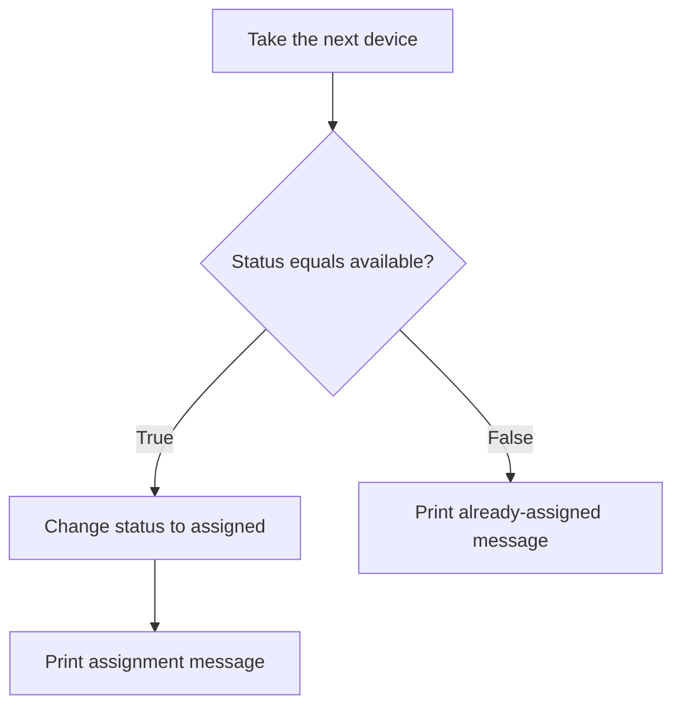
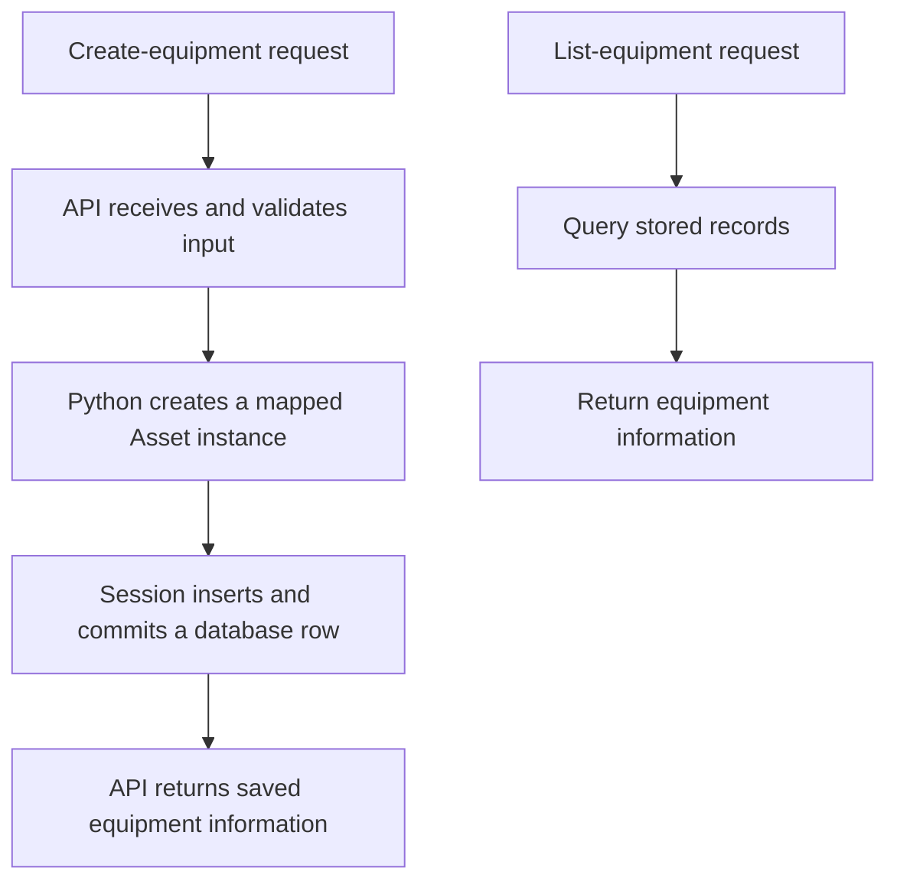
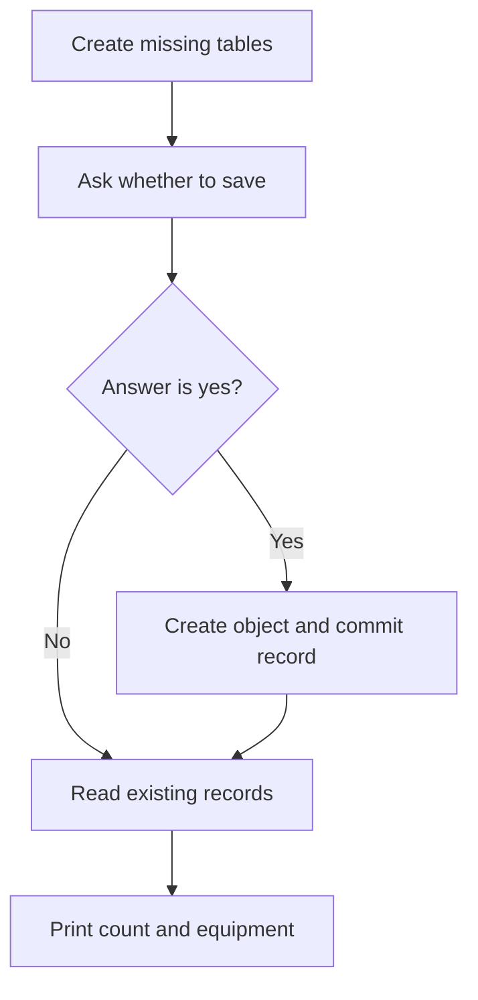
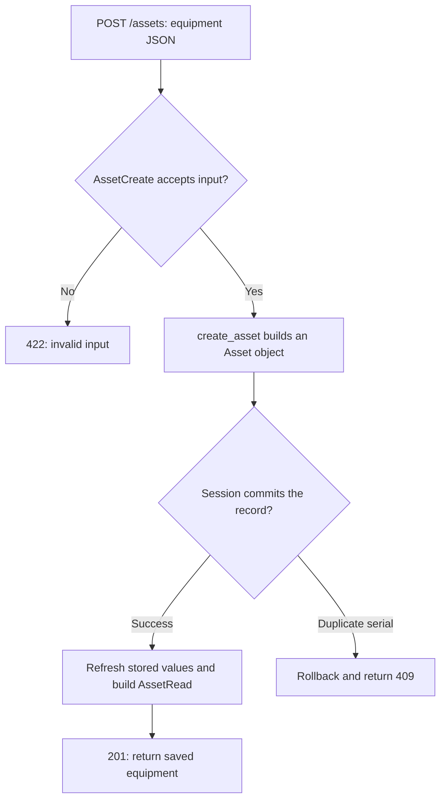

# AssetDesk — Python Foundations

A practical reference for Python fundamentals, database exercises and the first AssetDesk API endpoints.

The lessons build from dictionaries and functions to classes, database sessions and API requests. Sections 1–26 cover the standalone exercises; sections 27–33 explain the application structure, validation and asset creation. The application currently has health and create endpoints. API listing is the next feature.

## How to use this handbook

Read one lesson, predict its output, run it, and change one detail. Then try a similar example without copying the whole solution. Revisit a small example at the next session.

Examples marked **standalone** can run independently. Short fragments use definitions from the surrounding lesson. Alternative versions of a function or class are alternatives: do not paste every version into one file and expect them all to stay active. A later definition under the same name replaces the earlier one.

Use the **BEFORE → CHANGE → AFTER** labels to spot changes that are easy to overlook.

### Navigation

1. [Choose the right tool](#1-choose-the-right-tool)
2. [Variables and dictionaries](#2-variables-and-dictionaries)
3. [Functions and the dictionary they receive](#3-functions-and-the-dictionary-they-receive)
4. [Parameters and defaults](#4-parameters-and-defaults)
5. [Return versus print](#5-return-versus-print)
6. [Create a dictionary with a function](#6-create-a-dictionary-with-a-function)
7. [Lists and loops](#7-lists-and-loops)
8. [Conditions](#8-conditions)
9. [Classes and instances](#9-classes-and-instances)
10. [Initialization and self](#10-initialization-and-self)
11. [Methods](#11-methods)
12. [Lists of instances](#12-lists-of-instances)
13. [Earlier values and current attributes](#13-earlier-values-and-current-attributes)
14. [Complete class exercise](#14-complete-class-exercise)
15. [Common mistakes and syntax](#15-common-mistakes-and-syntax)
16. [Exercises](#16-exercises)
17. [Answers](#17-answers)
18. [Bridge to database storage](#18-bridge-to-database-storage)
19. [Original ORM exercise explained](#19-original-orm-exercise-explained)
20. [Run and commit a checkpoint](#20-run-and-commit-a-checkpoint)
21. [Add categories and understand indentation](#21-add-categories-and-understand-indentation)
22. [Complete interactive database exercise](#22-complete-interactive-database-exercise)
23. [Describe, create and save](#23-describe-create-and-save)
24. [Sessions, requests and results](#24-sessions-requests-and-results)
25. [Optional saving and troubleshooting](#25-optional-saving-and-troubleshooting)
26. [Database practice and answers](#26-database-practice-and-answers)

27. [From the exercises to the application](#27-from-the-exercises-to-the-application)
28. [Application database configuration](#28-application-database-configuration)
29. [Application model and generated values](#29-application-model-and-generated-values)
30. [Input and output schemas](#30-input-and-output-schemas)
31. [Application startup and routes](#31-application-startup-and-routes)
32. [Creating an asset through the API](#32-creating-an-asset-through-the-api)
33. [Tests, responses and checkpoints](#33-tests-responses-and-checkpoints)

## 1. Choose the right tool

Start with the task in ordinary English, then choose a tool.

| I need to… | Tool | Example |
|---|---|---|
| Refer to a value | Variable | `name = "Demo laptop"` |
| Group labeled details | Dictionary | `{"name": "Demo laptop", "status": "available"}` |
| Collect several items | List | `[monitor, printer]` |
| Name and reuse an action | Function | `change_status(printer, "assigned")` |
| Repeat an action for each item | Loop | `for device in devices:` |
| Choose whether an action happens | Condition | `if device["status"] == "available":` |
| Define an equipment type with data and related actions | Class | `class Asset:` |
| Represent a particular item of that type | Instance | `printer = Asset("Demo printer")` |
| Perform an action on that instance | Method call | `printer.make_available()` |
| Keep records after the process ends | Persistent storage | SQLite database file |

A class is not mandatory for every program. Dictionaries and functions are a valid approach. Classes become useful when a named type and its associated behaviour help organize the program, or a library such as an ORM uses classes for mapping data.

## 2. Variables and dictionaries

### One value

```python
# Give a text value a name so we can use it later.
name = "Demo laptop"
print(name)
```

Output: `Demo laptop`.

`name` is a variable name we chose. `"Demo laptop"` is a string: a text value. The equals sign assigns the value on the right to the target on the left.

### Several labeled details — standalone

```python
# BEFORE: group the details of one device in a dictionary.
monitor = {
    "name": "Demo monitor",
    "status": "available",
}

# Read the value stored under the status key.
print(monitor["status"])

# CHANGE: replace only the status value.
monitor["status"] = "assigned"

# AFTER: the name is unchanged, but the status is different.
print(monitor["name"])
print(monitor["status"])
```

Expected output:

```text
available
Demo monitor
assigned
```

| Part | Meaning |
|---|---|
| `monitor` | Our chosen variable referring to the dictionary |
| `"name"`, `"status"` | Text keys chosen for this dictionary |
| `"Demo monitor"`, `"available"` | Values stored under those keys |
| `{}` | Dictionary syntax in this example |
| `monitor["status"]` | Access the entry under the status key |

These values currently live in the Python process's memory. Nothing here writes a database or file.

## 3. Functions and the dictionary they receive

A function gives instructions a reusable name. Defining it does not execute its body. Calling it does.

### Standalone example

```python
def assign_device(device):
    # Change the dictionary supplied to this function.
    device["status"] = "assigned"


# BEFORE: two separate dictionaries.
monitor = {"name": "Demo monitor", "status": "available"}
keyboard = {"name": "Demo keyboard", "status": "available"}

# CHANGE: supply only the keyboard to the function.
assign_device(keyboard)

# AFTER: the monitor was not changed.
print(monitor["status"])
print(keyboard["status"])
```

Output:

```text
available
assigned
```

During `assign_device(keyboard)`, the parameter `device` refers to the same dictionary as `keyboard`. It is not a copy and not a second device. The instruction inside the function changes that supplied dictionary.

| Place | Name used for the dictionary |
|---|---|
| Outside the function | `keyboard` |
| Inside this call | `device` |

**Parameter:** a name in the function definition, such as `device`.

**Argument:** a value supplied when calling it, such as the dictionary referred to by `keyboard`.

```python
def make_available(device):
    # This action always chooses the same new status.
    device["status"] = "available"
```

Call that action with `make_available(keyboard)` when you want to make the keyboard available again.

## 4. Parameters and defaults

Instead of two functions that choose fixed statuses, let the caller choose the status:

```python
def change_status(device, new_status):
    # Put the caller's chosen value into the supplied dictionary.
    device["status"] = new_status
```

For `change_status(monitor, "assigned")`:

| Supplied argument | Parameter receiving it |
|---|---|
| `monitor` dictionary | `device` |
| `"assigned"` | `new_status` |

Read the instruction as: “In this device, store this new status.”

We add parameters when the caller needs to supply information. A parameter list is not a list of every piece of information the program will hold.

### Default argument

```python
def create_device(name, status="available"):
    # Use the supplied status, or available when it was omitted.
    return {"name": name, "status": status}
```

| Call | Starting status |
|---|---|
| `create_device("Demo mouse")` | `"available"` |
| `create_device("Demo laptop", "assigned")` | `"assigned"` |

The default is a starting value, not a permanent restriction. Later code can change the stored status.

## 5. Return versus print

`return` gives a result back to the calling code and ends that function call. `print` displays information in the terminal. Returning a result does not automatically print it.

### Standalone example

```python
def get_status(device):
    # Return information without changing the dictionary.
    return device["status"]


def get_name(device):
    # Return the name so other code can use it.
    return device["name"]


monitor = {"name": "Demo monitor", "status": "available"}

# Keep the returned values, then decide to display them.
current_status = get_status(monitor)
monitor_name = get_name(monitor)
print(current_status)
print(monitor_name)
```

Output:

```text
available
Demo monitor
```

Trace `current_status = get_status(monitor)`:

1. Supply the monitor dictionary.
2. Retrieve its status inside the function.
3. Return the string `"available"`.
4. Assign that returned string to `current_status`.

A function with no explicit return value returns `None`. `None` represents the absence of a value here. Our dictionary-changing functions work by modifying the supplied dictionary; they do not need to return a status to perform that modification.

## 6. Create a dictionary with a function

### Standalone example

```python
def create_device(name, status="available"):
    # Build a fresh dictionary each time the function is called.
    return {
        "name": name,
        "status": status,
    }


mouse = create_device("Demo mouse")
laptop = create_device("Demo laptop", "assigned")

print(mouse["status"])
print(laptop["status"])
```

Output:

```text
available
assigned
```

In `"name": name`, the quoted text on the left is a dictionary key. The unquoted name on the right is the parameter whose current value we store.

For `create_device("Demo mouse")`, that entry becomes `"name": "Demo mouse"`.

Each call creates a new dictionary because the function executes a new dictionary expression each time. We have centralized the instructions for constructing a consistent record.

## 7. Lists and loops

A list groups items in order. Positions start at zero. A list can contain dictionaries or class instances; choose access syntax based on the actual item type.

### Standalone example

```python
# BEFORE: create two dictionaries and group the existing dictionaries.
monitor = {"name": "Demo monitor", "status": "available"}
printer = {"name": "Demo printer", "status": "available"}
devices = [monitor, printer]

# CHANGE: item 1 is the printer, because positions start at zero.
devices[1]["status"] = "assigned"

# AFTER: visit each dictionary and display its current status.
for device in devices:
    print(device["status"])
```

Output:

```text
available
assigned
```

| Expression | Result |
|---|---|
| `devices[0]` | Monitor dictionary |
| `devices[1]` | Printer dictionary |
| `devices[1]["name"]` | `"Demo printer"` |

The list holds references to the existing dictionaries; it does not automatically duplicate them.

Read `for device in devices:` as: “Visit each item, and use the name `device` to refer to the current item while running the indented block.” We chose the loop variable name. The loop does not create a new device each round.

## 8. Conditions

Use a condition when an action should happen only in a particular situation.

| Symbol | Job |
|---|---|
| `=` | Assign a value |
| `==` | Compare values for equality |

### Standalone example

```python
def change_status(device, new_status):
    # Reuse the same update instruction for different dictionaries.
    device["status"] = new_status


monitor = {"name": "Demo monitor", "status": "available"}
printer = {"name": "Demo printer", "status": "assigned"}
devices = [monitor, printer]

# Check each device before deciding which branch to run.
for device in devices:
    if device["status"] == "available":
        change_status(device, "assigned")
        print(device["name"], "was assigned")
    else:
        print(device["name"], "was already assigned")
```

Output:

```text
Demo monitor was assigned
Demo printer was already assigned
```



Indentation identifies which instructions belong to the loop and which belong to each condition branch. Both indented lines beneath `if` run only when the condition is true.

To reverse the action:

```python
# Make assigned devices available; leave the others unchanged.
for device in devices:
    if device["status"] == "assigned":
        change_status(device, "available")
```

## 9. Classes and instances

A class defines a type of object. An instance is a particular object created from that class. A method is a function defined in the class; an ordinary instance method receives the instance through `self`.

Python dictionaries and lists are objects too. “Object” is a broad word; “Asset instance” identifies the particular type we mean.

### Standalone example

```python
class Asset:
    def __init__(self, name, status="available"):
        # Keep the starting values on each new instance.
        self.name = name
        self.status = status


# Create two separate instances using the same class definition.
monitor = Asset("Demo monitor")
printer = Asset("Demo printer", "assigned")

print(monitor.name)
print(printer.status)
```

Output:

```text
Demo monitor
assigned
```

| Dictionary approach | Class approach |
|---|---|
| `create_device("Demo monitor")` | `Asset("Demo monitor")` |
| Returns a dictionary | Creates an Asset instance |
| `monitor["name"]` | `monitor.name` |
| `monitor["status"]` | `monitor.status` |

Neither approach automatically saves data. Both initially represent information in memory.

## 10. Initialization and self

When we write `printer = Asset("Demo printer", "assigned")`, Python creates a new instance and automatically invokes `__init__` to initialize it. After initialization, `printer` refers to that instance. We normally do not call `printer.__init__(...)` ourselves.

| Inside initialization | Meaning for that call |
|---|---|
| `self` | The new printer instance |
| `name` | The supplied string `"Demo printer"` |
| `status` | The supplied string `"assigned"` |
| `self.name` | The attribute on the instance where we keep its name |
| `self.status` | The attribute on the instance where we keep its status |

Read `self.name = name` as: “Take the incoming name on the right and store it on this instance on the left.”

The names do not have to match:

```python
class Asset:
    def __init__(self, supplied_name):
        # supplied_name is the input; self.name is the stored attribute.
        self.name = supplied_name
        self.status = "available"
```

This alternative always chooses available internally. It accepts only the name. Compare the choices:

| Definition | Who chooses status? |
|---|---|
| `__init__(self, name)` with `self.status = "available"` | Initialization code always chooses it |
| `__init__(self, name, status)` | Caller must supply it |
| `__init__(self, name, status="available")` | Caller may supply it; otherwise use the default |

**We do not pass `self` explicitly in `Asset(...)`. Python handles the instance during initialization.**

## 11. Methods

### Standalone example

```python
class Asset:
    def __init__(self, name, status="available"):
        # Initialize this particular asset.
        self.name = name
        self.status = status

    def change_status(self, new_status):
        # The caller chooses the new value.
        self.status = new_status

    def make_available(self):
        # This action chooses its new value internally.
        self.status = "available"

    def rename(self, new_name):
        # Replace the name on the instance receiving the call.
        self.name = new_name

    def get_name(self):
        # Return the current name without changing it.
        return self.name

    def get_status(self):
        # Return the current status without changing it.
        return self.status


printer = Asset("Demo printer")
printer.change_status("assigned")
printer.rename("Office printer")
printer.make_available()
print(printer.get_name())
print(printer.get_status())
```

Output:

```text
Office printer
available
```

For `printer.change_status("assigned")`:

| Part of call | Inside the method |
|---|---|
| `printer.` | Python supplies this instance as `self` |
| `"assigned"` | Value received by `new_status` |

`printer.make_available()` needs no extra argument because the method already specifies available. Parentheses are still required to call it.

Method names must match their definitions. If we defined `rename`, call `printer.rename(...)`. `change_name` would be another reasonable name, but it does not exist unless we define it.

The getter methods are teaching examples. For this simple class, directly reading `printer.name` or `printer.status` is also appropriate; getters are not mandatory for every attribute.

## 12. Lists of instances

Using the Asset class from lesson 11:

```python
# Create instances and group them without copying them.
monitor = Asset("Demo monitor")
printer = Asset("Demo printer", "assigned")
assets = [monitor, printer]

# Select the printer first, then read its attribute.
print(assets[1].name)

# Change the same instance through its position in the list.
assets[1].rename("Office printer")
print(printer.name)

# Visit each instance and make assigned equipment available.
for asset in assets:
    if asset.status == "assigned":
        asset.make_available()
```

The two print statements display `Demo printer` and `Office printer`.

| Expression | Correct for |
|---|---|
| `devices[1]["name"]` | A dictionary at list position 1 |
| `assets[1].name` | Our Asset instance at list position 1 |
| `assets.name[1]` | Not valid for this list: it has no name attribute |

Break a combined expression into steps when uncertain:

```python
# First select the instance, then access its information.
selected_asset = assets[1]
print(selected_asset.name)
```

## 13. Earlier values and current attributes

Using the Asset class from lesson 11:

```python
# BEFORE: capture strings returned at this moment.
laptop = Asset("Demo laptop", "assigned")
saved_name = laptop.get_name()
old_status = laptop.get_status()

# CHANGE: these calls change the instance's attributes.
laptop.rename("Office laptop")
laptop.make_available()

# AFTER: compare earlier strings with the current attributes.
print(saved_name)
print(laptop.name)
print(old_status)
print(laptop.status)
```

Output:

```text
Demo laptop
Office laptop
assigned
available
```

The getters returned strings at the time they ran. Those variables do not become live queries. Reassigning the instance's attributes does not reassign `saved_name` or `old_status`.

| Name/expression | Earlier | After both changes |
|---|---|---|
| `saved_name` | Demo laptop | Demo laptop |
| `laptop.name` | Demo laptop | Office laptop |
| `old_status` | assigned | assigned |
| `laptop.status` | assigned | available |

This does not mean every returned value is automatically copied. In earlier examples, two names could refer to the same mutable dictionary or instance. Here we captured strings and later reassigned attributes to different strings.

## 14. Complete class exercise

**File: `learning/class_basics.py`. Standalone, no packages or database required.**

```python
class Asset:
    def __init__(self, name, status="available"):
        # Store the starting information on each new instance.
        self.name = name
        self.status = status

    def change_status(self, new_status):
        # Update the instance receiving this method call.
        self.status = new_status

    def get_status(self):
        # Give the caller this instance's current status.
        return self.status


# BEFORE: create one instance and read its starting status.
printer = Asset("Demo printer")
earlier_status = printer.get_status()

# CHANGE: update the existing printer instance.
printer.change_status("assigned")

# AFTER: read its status again.
latest_status = printer.get_status()

# Display the values captured before and after the change.
print("Earlier:", earlier_status)
print("Latest:", latest_status)
```

Run from the project root, in the activated environment:

```bash
# Run this file as a Python program.
python learning/class_basics.py
```

Initial expected output:

```text
Earlier: available
Latest: assigned
```

Change only the construction line to `printer = Asset("Demo printer", "assigned")`. Expected output:

```text
Earlier: assigned
Latest: assigned
```

In the second output, the instance starts assigned and the method sets it to assigned again. Section 21 extends this example with a category.

## 15. Common mistakes and syntax

| Syntax | Meaning in these examples |
|---|---|
| `name = value` | Assign a value to a name |
| `value == other` | Compare for equality |
| `function(...)` | Call a function |
| `Asset(...)` | Call the class to create an initialized instance |
| `printer.name` | Read an attribute |
| `printer.rename(...)` | Call the instance's method |
| `devices[0]` | Select a list item |
| `device["name"]` | Read a dictionary entry |
| `def ...:` | Define a function or method |
| `return ...` | Send a result back and end the call |

Troubleshooting checklist:

1. Did I close every parenthesis? `printer.rename("Office printer")` needs the final `)`.
2. Does the called name exactly match its definition?
3. Did I select the right list position? The second item is at position 1.
4. Does the selected item hold a dictionary or an Asset instance?
5. Did I miss a change between the starting data and the print statements?
6. Is the print reading a previously returned string or a current attribute?
7. Is the indentation placing the instruction in the intended block?

If `printer.change_name(...)` is called but only `rename` exists, Python reports an attribute error. That is a name mismatch, not a reason to redesign the class.

## 16. Exercises

Use the functions and class definitions from the appropriate lesson. Write an answer before checking section 17.

1. Given a dictionary `monitor`, set its status to assigned directly.
2. Call `assign_device` using a keyboard dictionary.
3. Complete `def get_name(device): return ____` for a dictionary.
4. Use `create_device` to make an available mouse, then an assigned laptop.
5. A dictionary list is `[monitor, printer]`. Read the printer's name through the list.
6. Write a dictionary loop that makes assigned devices available.
7. Create an Asset instance named Demo printer with status assigned.
8. For `monitor.change_status("assigned")`, what do `self` and `new_status` refer to?
9. An instance list is `[monitor, printer]`. Read the printer's name through the list.
10. Complete the body of `def rename(self, new_name):`.
11. Complete the body of `def make_available(self):` and call it on `printer`.
12. Complete the body of `def get_status(self):`, then store its result from `printer` in `current_status`.
13. A printer starts available. Capture `earlier = printer.get_status()`, then call `printer.change_status("assigned")`. What are `earlier` and `printer.status` now?
14. Why is status optional in `Asset("Demo mouse")` with our defaulted initializer?
15. Does creating an Asset instance save it to a database?

## 17. Answers

1. `monitor["status"] = "assigned"`
2. `assign_device(keyboard)`
3. `device["name"]`
4. `mouse = create_device("Demo mouse")`; separately, `laptop = create_device("Demo laptop", "assigned")`.
5. `devices[1]["name"]`, assuming the list variable is `devices`.
6. See below.
7. `printer = Asset("Demo printer", "assigned")`
8. `self` is the monitor instance; `new_status` receives the string `"assigned"`.
9. `assets[1].name`, assuming the list variable is `assets`.
10. `self.name = new_name`
11. Body: `self.status = "available"`. Call: `printer.make_available()`.
12. Body: `return self.status`. Call: `current_status = printer.get_status()`.
13. `earlier` is `"available"`; the current `printer.status` is `"assigned"`.
14. The initializer has `status="available"`, so the caller can omit that argument.
15. No. It creates information in the running process. Database operations are separate.

Answer 6:

```python
# Update only dictionaries whose status matches assigned.
for device in devices:
    if device["status"] == "assigned":
        change_status(device, "available")
```

## 18. Bridge to database storage

### What remains missing?

Our current class exercise stores information in memory. If the program stops, those instances are no longer available to the next run. To retain records, we need persistent storage.

| Concept | Plain explanation |
|---|---|
| SQLite | Database engine that can store this project's records in a local file |
| Table | A structure holding records of one kind |
| Column | One field, such as name or status |
| Row | One stored record |
| Primary key | A field or fields uniquely identifying a row; here an integer ID |
| SQL | Language used to request database operations |
| SQLAlchemy | Python library for working with databases |
| ORM | A way to connect Python classes/instances to tables/records |
| Engine | SQLAlchemy object managing database connectivity |
| Session | Coordinates ORM queries and tracked object changes |
| Transaction | Database work committed together or rolled back |
| Commit | Make the transaction's changes committed |

An equipment table could contain:

| id | name | category | status |
|---|---|---|---|
| 1 | Demo laptop | laptop | available |

In our chosen ORM approach:

| Python concept | Database connection |
|---|---|
| Mapped Asset class | Describes the assets table |
| A saved Asset instance | Corresponds to a row |
| Asset attributes | Correspond to column values |

The plain practice class is not automatically a mapped database class. The ORM model adds SQLAlchemy-specific declarations. It also does not automatically inherit the practice methods such as `rename` or `make_available`.

### Request flow: creation and planned listing



The API handles requests and responses. Pydantic describes and validates accepted/output data. A SQLAlchemy mapped model describes database storage. A list is still useful for holding multiple results; functions still organize the actions.

## 19. Original ORM exercise explained

**Optional command-line reference.** Section 22 contains the simpler interactive table exercise. This alternative uses `--add` instead of an input prompt; it is not required before beginning the API.

This version follows SQLAlchemy 2.0-style ORM declarations. It needs SQLAlchemy installed; the plain class exercise does not.

### The complete reference script

```python
"""Practice saving and reading fictional equipment with SQLAlchemy."""

import argparse
from pathlib import Path

from sqlalchemy import URL, create_engine, select
from sqlalchemy.orm import DeclarativeBase, Mapped, Session, mapped_column


# Build an absolute location beside this script; do not depend on the terminal folder.
DATABASE_PATH = Path(__file__).resolve().parent / "learning.db"

# Configure SQLite to use that file. str converts the Path object to text.
DATABASE_URL = URL.create("sqlite", database=str(DATABASE_PATH))

# Prepare connectivity; this line alone does not create our equipment table.
engine = create_engine(DATABASE_URL)


class Base(DeclarativeBase):
    """Provide the shared mapping foundation and table metadata."""


class Asset(Base):
    """Describe how equipment attributes map to database columns."""

    __tablename__ = "assets"

    # The database generates an ID when inserting a new row without one.
    id: Mapped[int] = mapped_column(primary_key=True)
    name: Mapped[str] = mapped_column(nullable=False)
    category: Mapped[str] = mapped_column(nullable=False)
    status: Mapped[str] = mapped_column(nullable=False)


def main() -> None:
    # Parse the optional --add flag. Without it, only list stored records.
    parser = argparse.ArgumentParser(description="Practice equipment storage.")
    parser.add_argument(
        "--add",
        action="store_true",
        help="Save one fictional laptop before listing records.",
    )
    args = parser.parse_args()

    # Use our collected descriptions to create tables that do not yet exist.
    Base.metadata.create_all(engine)
    print(f"Database: {DATABASE_PATH}")

    if args.add:
        # Construct a Python instance. It has not yet been persisted.
        laptop = Asset(
            name="Demo laptop",
            category="laptop",
            status="available",
        )

        # Close this session automatically after its block finishes.
        with Session(engine) as session:
            session.add(laptop)  # Register the new instance for insertion.
            session.commit()  # Flush pending work and commit the transaction.
            print(f"Saved asset ID: {laptop.id}")

    # Use a fresh session to read persisted records back.
    with Session(engine) as session:
        statement = select(Asset).order_by(Asset.id)
        assets = session.scalars(statement).all()

        print(f"Stored assets: {len(assets)}")
        for asset in assets:
            print(
                f"{asset.id} | {asset.name} | "
                f"{asset.category} | {asset.status}"
            )


# Importing this module does not call main; running it directly does.
if __name__ == "__main__":
    main()
```

### Imports: where the tools come from

`import` makes code from another module available. `argparse` and `pathlib` are included with Python. SQLAlchemy is an additional installed package.

| Imported name | Job in this exercise |
|---|---|
| `argparse` | Read options typed after the script's filename |
| `Path` | Represent and manipulate filesystem paths |
| `URL` | Construct a database connection description |
| `create_engine` | Create the connectivity object |
| `select` | Construct a database selection statement |
| `DeclarativeBase` | Foundation for our mapped classes |
| `Mapped` | Annotate attributes that participate in ORM mapping |
| `mapped_column` | Configure database columns |
| `Session` | Coordinate ORM operations |

### Path versus connection URL versus engine

`__file__` identifies the script file. `Path(__file__)` represents its path. `.resolve()` obtains an absolute resolved path; `.parent` selects its containing directory. The `/ "learning.db"` operation joins a child filename to the path; here `/` is a Path operation, not numeric division.

`DATABASE_PATH` is our chosen variable name. Uppercase is a convention for a value intended to remain constant; Python does not enforce immutability because of capitalization.

`URL.create("sqlite", database=str(DATABASE_PATH))` describes the database type and file location. It is not a webpage URL and does not involve opening a browser. The `database=` part names an argument accepted by the library. `str(...)` provides the filename as text.

The engine is not the database itself. Creating the engine configures connectivity; actual connections are opened when needed by database operations.

### What Base and metadata mean

`class Base(DeclarativeBase)` defines a class using behaviour inherited from SQLAlchemy's base class. Our `Asset` then inherits through that shared Base.

“Table definitions” means descriptions such as: table name, column names, types and constraints. `Base.metadata` collects these descriptions. It does not hold the actual laptop records.

`Base.metadata.create_all(engine)` uses those descriptions to create missing tables in the database reached through the engine. It is not a general migration tool: changing the mapped class later does not automatically update every existing table column.

### Mapped attributes

`__tablename__` is a special attribute SQLAlchemy recognizes. Setting it to `"assets"` names the mapped table; the assignment itself does not execute CREATE TABLE.

`id: Mapped[int]` declares an integer mapped attribute. `name: Mapped[str]` declares a text mapped attribute. `mapped_column(primary_key=True)` configures the primary key. `nullable=False` prohibits SQL NULL, not empty text: `""` is still a value. This model alone does not restrict status to available or assigned.

These basic mapping patterns can also be used with PostgreSQL. Database connection configuration and drivers differ, and database-specific behaviour must still be checked. Changing the connection URL does not move existing rows from SQLite to PostgreSQL.

SQLAlchemy supplies construction behaviour for this mapped class, so `Asset(name=..., category=..., status=...)` works without the explicit initializer used in our plain class lesson.

### main and command-line arguments

`def main() -> None` defines a function with no useful returned result. `-> None` is a type annotation; it is not an instruction that prevents Python from returning another value.

`parser` is our chosen variable for the argument parser object. `parser.add_argument(...)` defines an accepted option. `action="store_true"` makes `args.add` true when `--add` is present and false when it is absent. `parser.parse_args()` reads the supplied command-line arguments.

`args.add` is a boolean attribute created through argument parsing. It is not the same as the method `session.add(laptop)`. Similar spelling does not mean the same object or action.

### Session and transaction

`Session(engine)` constructs a session using the engine. `with ... as session:` lets us use it through the chosen variable `session` and ensures the session closes when leaving the block.

`session.add(laptop)` registers a new mapped instance as pending insertion. `session.commit()` flushes pending changes to the database and commits the transaction. Simply leaving `with Session(...)` does not automatically commit changes; that is why the explicit commit is present.

The code intentionally uses a separate session to read records back. The second session accesses persisted data, rather than relying on a list retained from the first operation.

### Query, ordering and result list

`select(Asset)` constructs a query for mapped assets. `.order_by(Asset.id)` adds ordering by ID. Its parentheses pass the ordering expression into the method.

At this point `Asset.id` is a class-level mapped attribute used to describe the query; `asset.id` inside the later loop is an individual instance's ID value.

`session.scalars(statement)` executes the selection and provides the selected Asset instances. `.all()` collects them into a list. Then the familiar `for asset in assets:` loop visits them.

The conceptual SQL is:

```sql
-- Retrieve stored records in ID order.
SELECT id, name, category, status
FROM assets
ORDER BY id;
```

### Formatted output

`f"Stored assets: {len(assets)}"` is an f-string. Python evaluates the expression inside braces and inserts its result into the text. `len(assets)` counts the list items.

`f"{asset.id} | {asset.name}"` inserts those attribute values. The vertical bar is just a printed separator. Adjacent string literals inside the same parentheses combine into one string in the multi-line print call.

### Direct execution guard

When the file is run directly, its `__name__` is `"__main__"`, so the final condition calls `main()`. Importing it normally gives it a module name and skips that call. The module-level setup still executes on import; the guard applies specifically to the guarded `main()` call.

### Running the optional command-line version

These commands apply only if you have saved this optional reference as `learning/orm_basics.py`. The application does not require that script.

Run from the project root after dependencies are installed:

```bash
# Create missing tables and list records without inserting.
python learning/orm_basics.py

# Insert one fictional laptop, then list records.
python learning/orm_basics.py --add

# Start another process and confirm the saved laptop remains.
python learning/orm_basics.py
```

Each run with `--add` inserts another record. The database file is local and excluded from Git. The original minimum success check is create → list → restart → list again.

## 20. Run and commit a checkpoint

Save this handbook as `docs/python-foundations.md` in the local project. Markdown is suitable for explanations, code blocks and diagrams and can be reviewed in Git. No notebook installation is required. Open Markdown Preview in VS Code to read the formatted document. GitHub renders the Mermaid diagrams; some local previews may show diagram source unless Mermaid support is available.

From the project root:

```bash
# Activate the project environment and run the known class example.
source .venv/bin/activate
python learning/class_basics.py

# Review current changes before choosing files for a commit.
git status --short
git --no-pager diff

# Example: select a completed handbook update.
git add docs/python-foundations.md

# Review exactly what will be recorded.
git --no-pager diff --cached

# Record and publish the verified learning checkpoint.
git commit -m "Expand Python and database learning notes"
git push
```

Do not accidentally include an unverified ORM script or unrelated changes in this commit. Keep local databases, caches and the virtual environment ignored. These commands are instructions for the local project, not a statement that a commit has already been made.

### Moving into the application

Use these examples as references while building the API. Memorizing every library name is not a prerequisite. Practise explaining the flow, changing a small behaviour, and checking the result.

The application now has a health endpoint, input schemas and an equipment creation endpoint. Sections 27–33 explain how those parts fit together. Its database is separate from the learning databases, and it does not import the interactive exercise scripts. Listing equipment through the API is the next application checkpoint.

### Optional references

- [Python tutorial: data structures](https://docs.python.org/3.14/tutorial/datastructures.html)
- [Python tutorial: functions](https://docs.python.org/3.14/tutorial/controlflow.html#defining-functions)
- [Python tutorial: classes](https://docs.python.org/3.14/tutorial/classes.html)
- [SQLAlchemy 2.0 ORM quick start](https://docs.sqlalchemy.org/en/20/orm/quickstart.html)

Use these for lookup. Reading them all is not a prerequisite for the next small exercise.

## 21. Add categories and understand indentation

This is an extended plain Python class, separate from the SQLAlchemy model. Earlier examples without categories remain valid as standalone lessons.

```python
class Asset:
    def __init__(self, name, category, status="available"):
        # Inputs on the right become stored attributes on this instance.
        self.name = name
        self.category = category
        self.status = status

    def change_status(self, new_status):
        self.status = new_status

    def get_status(self):
        return self.status


printer = Asset("Demo printer", "printer", "assigned")
earlier_status = printer.get_status()
printer.change_status("assigned")
latest_status = printer.get_status()
print("Earlier:", earlier_status)
print("Latest:", latest_status)
print("Category:", printer.category)

keyboard = Asset("Demo keyboard", "keyboard")
print(keyboard.name, keyboard.category, keyboard.status)
```

Output:

```text
Earlier: assigned
Latest: assigned
Category: printer
Demo keyboard keyboard available
```

| Input | Where it goes |
|---|---|
| `"Demo keyboard"` | `name`, then `self.name` |
| `"keyboard"` | `category`, then `self.category` |
| Status omitted | Default `"available"`, then `self.status` |

`self` refers to the particular instance receiving the method call. Use lowercase consistently: `Self` is a different name. The conventional name `self` is not a Python keyword, but changing its capitalization in only one place breaks the reference.

Indentation is part of Python syntax:

| Indentation in this example | Code |
|---|---|
| 0 spaces | `class Asset:` and the code that creates instances |
| 4 spaces | Method definitions inside the class |
| 8 spaces | Instructions inside those methods |

If `self.name = name` is aligned with `def __init__`, it is outside the method body. Move it inside the method; do not change `self` to `Self` to fix an indentation problem.

## 22. Complete interactive database exercise

**File: `learning/table_basics.py`. Requires SQLAlchemy.**

This is a standalone reference for the exercise developed in small steps. It does not depend on the plain Asset class above. Do not combine the two class definitions into one script.

```python
from pathlib import Path

from sqlalchemy import URL, create_engine, select
from sqlalchemy.orm import DeclarativeBase, Mapped, Session, mapped_column


# Locate the database beside this script, regardless of terminal location.
SCRIPT_FOLDER = Path(__file__).resolve().parent
DATABASE_PATH = SCRIPT_FOLDER / "table_basics.db"
DATABASE_URL = URL.create("sqlite", database=str(DATABASE_PATH))

# Prepare the object that manages database connections.
engine = create_engine(DATABASE_URL)


class Base(DeclarativeBase):
    """Provide the shared mapping foundation."""


class Asset(Base):
    """Describe the assets table and its columns."""

    __tablename__ = "assets"

    # SQLite supplies an integer ID when we insert without one.
    id: Mapped[int] = mapped_column(primary_key=True)
    # SQL NULL is prohibited; blank strings are not rejected here.
    name: Mapped[str] = mapped_column(nullable=False)
    category: Mapped[str] = mapped_column(nullable=False)
    status: Mapped[str] = mapped_column(nullable=False)


# Create missing tables; retain existing records.
Base.metadata.create_all(engine)

answer = input("Save a new demo laptop? Type yes or no: ")

# Only this indented block depends on the answer.
if answer == "yes":
    laptop = Asset(
        name="Demo laptop",
        category="laptop",
        status="available",
    )
    print("Before saving:", laptop.name, laptop.id)

    with Session(engine) as session:
        session.add(laptop)
        session.commit()
        print("After saving:", laptop.name, laptop.id)

# Outside the if: run these instructions for either answer.
print("Database file:", DATABASE_PATH)
print("Table:", Asset.__tablename__)
print("Columns:", list(Asset.__table__.columns.keys()))

with Session(engine) as session:
    # Prepare a request. This line alone does not retrieve records.
    statement = select(Asset).order_by(Asset.id)

    # Execute the request and collect its Asset objects into a list.
    assets = session.scalars(statement).all()

    print("Stored assets:", len(assets))
    for asset in assets:
        print(asset.id, asset.name, asset.category, asset.status)
```

Run from the project root with the virtual environment activated:

```bash
python learning/table_basics.py
```

Only the exact answer `yes` inserts a laptop. Answering `no`, entering different text, or pressing Enter skips insertion and continues to reading. Every `yes` creates a separate record; the name is not unique in this model.

## 23. Describe, create and save

These are separate operations:

| Code | What happens |
|---|---|
| `DATABASE_PATH = ...` | Choose a file location; do not create it yet |
| `URL.create(...)` | Describe the database type and location |
| `create_engine(...)` | Prepare connection management; no connection yet |
| `class Asset(Base): ...` | Define the table mapping in Python |
| `__tablename__ = "assets"` | Name the mapped table |
| `Base.metadata.create_all(engine)` | Connect and create missing tables |
| `laptop = Asset(...)` | Create an equipment object in memory |
| `session.add(laptop)` | Register this new object for insertion |
| `session.commit()` | Flush pending changes and commit the transaction |

For this SQLite setup, connecting creates the database file if missing. `create_all` creates missing tables, but does not automatically change existing columns to match later edits. It does not add equipment records.

### Why the ID starts as None

```python
laptop = Asset(name="Demo laptop", category="laptop", status="available")
print(laptop.name, laptop.id)
```

Before insertion, this prints:

```text
Demo laptop None
```

`None` belongs to the ID attribute only. The object exists, and the three supplied values are present.

| Attribute | Before insertion | After insertion, example |
|---|---|---|
| `laptop.name` | Demo laptop | Demo laptop |
| `laptop.category` | laptop | laptop |
| `laptop.status` | available | available |
| `laptop.id` | None | 1 |

SQLite generates the ID when SQLAlchemy inserts the row, and SQLAlchemy retrieves it for the object. In this exercise, insertion happens during the flush performed by `commit()`. More generally, a flush can happen before commit, so having an ID is not by itself proof of a committed transaction.

`laptop` is a variable referring to the object. It is not the object's database ID. SQLAlchemy supplies an initializer for our mapped class, so the keyword arguments work without writing our own `__init__`.

## 24. Sessions, requests and results

### Read the session line in English

```python
with Session(engine) as session:
    # Database work goes here.
    statement = select(Asset)
    assets = session.scalars(statement).all()
```

“Create a session using our engine, call it `session`, do the indented work, then close the session when leaving the block.” The underlying connection is acquired as needed.

| Piece | Role |
|---|---|
| `Session(engine)` | Create the ORM work session using this engine |
| `as session` | Give us a variable referring to that session |
| `with` | Manage cleanup when the block ends, including on an exception |

The session can read, insert, update or delete. It is the code inside the block that chooses the operation. Closing it does not delete committed records. In `with Session(engine)`, closing does not automatically commit pending changes.

We used two sessions to separate saving from reading. Two are not mandatory. The reading block is outside the condition so it also runs when saving is skipped.

### A request is different from its answer

```python
# Prepare the request.
statement = select(Asset).order_by(Asset.id)

# Execute the request and collect the returned objects.
assets = session.scalars(statement).all()
```

| Variable | Contents | Plain English |
|---|---|---|
| `statement` | A query object | “Get all assets, ordered by ID.” |
| `assets` | A Python list of Asset objects | “Here is the equipment returned by that request.” |

Preparing `statement` alone does not fetch equipment. `.order_by(Asset.id)` asks for ascending ID order by default.

The second line can be expanded without changing its meaning:

```python
# Execute the request; the result provides individual Asset objects.
result = session.scalars(statement)

# Collect all returned objects into a list.
assets = result.all()
```

For `select(Asset)`, `scalars` exposes each selected Asset object rather than a row wrapper. `.all()` collects the results; it does not perform an INSERT.

Our variable names are choices. The following is equivalent:

```python
with Session(engine) as session:
    request = select(Asset).order_by(Asset.id)
    equipment = session.scalars(request).all()
    for device in equipment:
        print(device.name)
```

### Use the returned list

If the query returns a laptop followed by a monitor:

| Expression | Meaning |
|---|---|
| `assets` | The list containing both objects |
| `assets[0]` | The laptop object |
| `assets[1].name` | The monitor's name |
| `len(assets)` | 2 |

```python
for asset in assets:
    print(asset.name, asset.status)
```

On each turn, `asset` refers to one object from the list. Printing does not insert a record. If no rows match, `assets` is `[]`, its length is zero, and the loop runs zero times. Accessing `assets[0]` on an empty list raises `IndexError`.

Keep attribute access inside the session in these exercises. Some ORM attributes can require further database access; do not assume every object remains fully usable after its session closes.

### Do reads need add or commit?

| Goal | Operations in this exercise |
|---|---|
| Insert new equipment | `session.add(laptop)` then `session.commit()` |
| Read existing equipment | `session.scalars(statement).all()` |

Our reading block makes no changes and needs neither `add()` nor `commit()`. A database with eight rows still has eight rows after this reading block runs three times.

## 25. Optional saving and troubleshooting



`input()` waits for text and Enter. `answer = ...` stores that text; `answer == "yes"` compares it with a string. Only the indented saving block depends on the comparison.

### Duplicate saving block

If the old saving code remains outside the condition, a yes run may print:

```text
Before saving: Demo laptop None
After saving: Demo laptop 7
Before saving: Demo laptop 7
After saving: Demo laptop 7
```

The repeated ID is a clue that the same object was used again. Adding that already-saved, unchanged object to another session does not automatically insert a fresh row. Remove the leftover block; keep only the saving session inside the condition.

On a fresh no run, the leftover block would try to use `laptop` even though the conditional construction did not run. That causes `NameError`. The reading query does not need that variable and should remain outside the condition.

### Check persistence and optional saving

Run the script three separate times. If you start with seven rows:

| Run | Answer | Expected rows |
|---|---|---|
| First | no | 7 |
| Second | yes | 8 |
| Third | no | 8 |

Use your actual starting count; do not delete the database just to match these numbers. The important result is unchanged count, then one extra row, then unchanged count. Only the yes run prints the before/after saving messages.

### Files and project boundaries

- `learning/table_basics.py` uses `learning/table_basics.db`.
- The optional `learning/orm_basics.py` uses a different file, `learning/learning.db`.
- Their records are separate. Running one script does not show the other's database.
- Commit working exercises and documentation; keep generated databases and `.venv` ignored.
- Do not import the interactive table exercise into the API: its top-level code prompts and performs database operations on import.
- Keep README instructions concise. Put explanations, practice and troubleshooting in this handbook.

## 26. Database practice and answers

Try these without running the code first. Then check the answers.

1. Does assigning `__tablename__ = "assets"` create the physical table?
2. Which instruction creates missing tables?
3. Why can `laptop.name` be present while `laptop.id` is None?
4. Does preparing `statement` retrieve equipment?
5. Which variable supports selecting the first returned object: `statement` or `assets`?
6. What does `assets` contain if there are no matching records?
7. Does a read-only query require `session.add()` or `session.commit()`?
8. Why does reading still run after answering no?
9. What happens when a new object with the same name is inserted again?
10. Does `nullable=False` reject a name containing only spaces?

### Answers

1. No. It names the table in the mapping description.
2. `Base.metadata.create_all(engine)`.
3. We supplied the name but left the ID for the database to generate on insertion.
4. No. Executing the query through the session retrieves results.
5. `assets`, using `assets[0]` when the list is not empty.
6. An empty list, `[]`.
7. Neither is needed in our read-only block.
8. Its block is outside the conditional saving block.
9. Another row is created with its own ID; this table has no unique constraint on name.
10. No. It rejects SQL NULL. Input validation must separately reject blank or whitespace-only text.

## 27. From the exercises to the application

The exercises taught individual tools. The application combines them to do one job:
receive equipment details, check them, store a record, and return its saved details.

The application code lives in `app/`. These are our organization choices, not mandatory
Python or FastAPI filenames. Keeping separate responsibilities in separate files makes
it easier to locate the code we need to understand or change.

| File | Question it answers | Contents |
| --- | --- | --- |
| `app/database.py` | Where is the database and how do we connect? | Path, connection URL, engine and shared Base |
| `app/models.py` | How is equipment stored? | The Asset class, its columns and storage rules |
| `app/schemas.py` | What information can enter and leave the API? | AssetCreate and AssetRead |
| `app/main.py` | What happens when a request arrives? | Application startup, routes and saving logic |
| `tests/test_schemas.py` | Do our input rules behave as expected? | Automated validation checks |

`database.py` is a Python source file. `assetdesk.db` is a SQLite data file. They are not
two names for the same thing. We commit source code; we keep the generated database local.

Our application does not import the interactive scripts in `learning/`. They remain
separate examples and use their own database files.

### One request through the application



This is the request path implemented by the current create endpoint. An unrelated database
failure is raised for investigation; it is not converted into a duplicate-serial message.
Listing equipment through the API is the next feature, not part of this checkpoint.

### Three representations of the same equipment

| Name | What it is | Why it exists |
| --- | --- | --- |
| `AssetCreate` | A Pydantic class | Describe acceptable creation input |
| `equipment` | One AssetCreate object | Hold checked values from this request |
| `Asset` | A SQLAlchemy mapped class | Describe the equipment table and mapping |
| `asset` | One Asset object | Represent the equipment to insert and its stored values |
| `AssetRead` | A Pydantic class | Describe the information returned to the caller |

These are not three different laptops or three database rows. They describe the same
information at different stages. The database insertion creates the stored row.

### Why a class here, and a function there?

Use a class when describing one of these types of data with the library's class-based
interface. Use a function for a sequence of work, such as getting the current time or
handling a request.

`class AssetCreate(BaseModel)` means “define our class using Pydantic's BaseModel
capabilities.” This is inheritance. We declare the fields and rules; the library supplies
validation and construction behavior. We do not need to write our own `__init__` here.

`class Asset(Base)` uses SQLAlchemy's capabilities through our shared Base instead.
It describes database storage. Pydantic and SQLAlchemy do different jobs even though
both use Python classes.

## 28. Application database configuration

**File: `app/database.py`.** These are the core declarations used by the application:

```python
from pathlib import Path

from sqlalchemy import URL, create_engine
from sqlalchemy.orm import DeclarativeBase

# Locate the project folder from this module's location.
PROJECT_ROOT = Path(__file__).resolve().parent.parent
DATABASE_PATH = PROJECT_ROOT / "assetdesk.db"

# Describe connectivity, then create the connection-management object.
DATABASE_URL = URL.create("sqlite", database=str(DATABASE_PATH))
engine = create_engine(DATABASE_URL)


class Base(DeclarativeBase):
    """Provide the shared foundation for our database models."""
```

Read the path expression in order:

| Expression | Meaning |
| --- | --- |
| `__file__` | This module's filename |
| `Path(__file__)` | Represent that filename as a Path object |
| `.resolve()` | Obtain its absolute resolved path |
| First `.parent` | Move from database.py to its containing app folder |
| Second `.parent` | Move from app to the project root |
| `/ "assetdesk.db"` | Join the folder path with the database filename |

The `/` operation joins path parts because the left-hand value is a Path object.
It is not numeric division in this expression.

`DATABASE_PATH` is our chosen name for that file location. Uppercase is a naming
convention for a configuration value; it does not make the value immutable.

`URL.create("sqlite", database=str(DATABASE_PATH))` tells SQLAlchemy the database system
and its filename. This is not a website URL. `str()` converts the Path object to the text
expected by that argument. `database=` is the name of an argument in the library function.

`engine` manages connectivity to that database. Creating the engine does not insert a
record or create the assets table. Database work opens connections when needed.

`Base.metadata` collects table descriptions from mapped classes that inherit from Base.
A table description includes names, column types and constraints. It does not contain
our stored equipment records.

The three things to distinguish are:

- `DATABASE_PATH`: which file to use.
- `engine`: how database connections are managed.
- `Base.metadata`: the table descriptions SQLAlchemy knows about.

## 29. Application model and generated values

**File: `app/models.py`.** The current application model has seven columns:

| Column | Meaning | Source when creating equipment |
| --- | --- | --- |
| `id` | Unique integer identifier | SQLite generates it during insertion |
| `name_alias` | A useful label such as Reception laptop | Validated request input |
| `category` | Equipment type | Validated request input |
| `brand` | Manufacturer | Validated request input |
| `serial_number` | Optional unique serial | Validated request input, or None |
| `status` | available or assigned in accepted API input | Request value, or its default |
| `created_at` | Creation time with a UTC offset | Model default during insertion |

For example:

```python
# A mapped attribute and its column rule.
name_alias: Mapped[str] = mapped_column(nullable=False)
```

`Mapped[str]` identifies a mapped text attribute. `mapped_column()` configures its column.
`nullable=False` rejects SQL NULL, not blank text. Pydantic handles the blank-text rule.

```python
# Missing serial numbers are allowed; supplied values must be unique.
serial_number: Mapped[str | None] = mapped_column(
    nullable=True,
    unique=True,
)
```

`str | None` allows text or None in Python. `nullable=True` allows SQL NULL in SQLite.
`unique=True` makes SQLite reject duplicate non-NULL serial numbers. SQLite allows more
than one NULL in this unique column. Serial comparison is case-sensitive with this
current column configuration.

### Greek local creation time

```python
from datetime import datetime
from zoneinfo import ZoneInfo


def current_greek_time() -> str:
    """Return Greek local time with its UTC offset."""
    return datetime.now(ZoneInfo("Europe/Athens")).isoformat(
        timespec="seconds"
    )
```

`-> str` is a return type hint. The function produces text. `Europe/Athens` uses Greece's
timezone rules, including seasonal clock changes. It is not a fixed offset all year.
`isoformat(timespec="seconds")` formats the date and time to the second and includes the
offset, for example `2026-10-27T16:12:59+02:00`.

The mapped column uses the function like this:

```python
created_at: Mapped[str] = mapped_column(
    nullable=False,
    default=current_greek_time,
)
```

There are deliberately no parentheses after `current_greek_time`. We pass the function
so SQLAlchemy can call it when inserting a row that needs the default. Calling it while
defining the class would calculate one timestamp too early.

The current model stores this timestamp as text. A model default is applied during
insertion; constructing an Asset object alone does not populate every generated value.

## 30. Input and output schemas

**File: `app/schemas.py`.** A schema here is a description of fields, types and rules.

### AssetCreate: what the caller may send

```python
from typing import Literal

from pydantic import BaseModel, ConfigDict, Field


class AssetCreate(BaseModel):
    """Information accepted when creating equipment."""

    # Clean surrounding spaces and reject undeclared fields.
    model_config = ConfigDict(
        str_strip_whitespace=True,
        extra="forbid",
    )

    name_alias: str = Field(min_length=1)
    category: str = Field(min_length=1)
    brand: str = Field(min_length=1)
    serial_number: str | None = Field(default=None, min_length=1)
    status: Literal["available", "assigned"] = "available"
```

| Declaration | Plain English |
| --- | --- |
| `BaseModel` | Supply Pydantic's checking and construction behavior |
| `str_strip_whitespace=True` | Remove spaces surrounding input strings |
| `extra="forbid"` | Reject fields we did not declare |
| `Field(min_length=1)` | Require at least one character after trimming |
| `default=None` | Use None when the serial is omitted |
| `Literal["available", "assigned"]` | Accept only these exact status values |
| `= "available"` | Use available if the caller omits status |

We leave ID and creation time out of this input class because the saving process supplies
them. Combined with `extra="forbid"`, this rejects callers trying to supply an ID.

Example, run independently from the project root:

```python
from app.schemas import AssetCreate

# Construct checked input. This does not access or modify the database.
equipment = AssetCreate(
    name_alias="  Reception laptop  ",
    category="laptop",
    brand="Lenovo",
)

print(equipment.name_alias)     # Reception laptop
print(equipment.serial_number)  # None
print(equipment.status)         # available
```

The values are attributes on an object, so use `equipment.status`, not
`equipment["status"]`. Our input object is not a dictionary.

### AssetRead: what the caller receives

```python
class AssetRead(BaseModel):
    """Equipment information returned by the API."""

    model_config = ConfigDict(from_attributes=True)

    id: int
    name_alias: str
    category: str
    brand: str
    serial_number: str | None
    status: Literal["available", "assigned"]
    created_at: str
```

The response includes the ID and creation time. `from_attributes=True` allows Pydantic
to read attributes from our SQLAlchemy object, such as `asset.id` and `asset.brand`.

`AssetRead` does not perform a database query. It describes returned data. The session
performs database reads; the schema checks and organizes the response values.

### Why fields appear in both the model and schemas

| Responsibility | Where it belongs in this application |
| --- | --- |
| Is the submitted alias blank? | AssetCreate |
| What text values can status contain in a request? | AssetCreate |
| Is this serial already stored? | Database unique constraint, handled by the route |
| Which columns are stored? | Asset in models.py |
| Which fields should be returned? | AssetRead |

The current database model has no CHECK constraint limiting status to the two API
values. The accepted-status rule is enforced by the input schema. This distinction
matters when explaining what each layer does.

## 31. Application startup and routes

**File: `app/main.py`.** This connects the database setup, models and schemas.

### Imports

| Imported name | Role |
| --- | --- |
| `asynccontextmanager` | Adapt the lifespan function to the startup/shutdown pattern |
| `SQLITE_CONSTRAINT_UNIQUE` | Identify SQLite's unique-value violation code |
| `FastAPI` | Construct the web application |
| `HTTPException` | Deliberately return an HTTP error response |
| `IntegrityError` | Catch database integrity-rule failures reported by SQLAlchemy |
| `Session` | Coordinate ORM work through the engine |
| `Base`, `engine` | Reuse our database setup |
| `Asset` | Reuse the equipment table mapping |
| `AssetCreate`, `AssetRead` | Reuse request and response definitions |

`from app.models import Asset` means “bring the Asset name from the models module in
app into this module.” Importing the model also registers its table description with
our shared Base before startup calls create_all.

### Startup and shutdown

```python
@asynccontextmanager
async def lifespan(app: FastAPI):
    # Prepare missing tables before accepting requests.
    Base.metadata.create_all(engine)
    yield
    # Release pooled connections during normal shutdown.
    engine.dispose()


app = FastAPI(title="AssetDesk API", lifespan=lifespan)
```

The lifespan function runs in three stages:

1. Before `yield`: create missing tables.
2. At `yield`: pause this function while the application serves requests.
3. After `yield`: perform shutdown cleanup.

`create_all` creates missing tables described by Base.metadata. It does not insert assets,
erase existing rows, or automatically alter an existing table to match edited columns.
The SQLite database file is created on connection if it is missing.

`async def` is part of this lifecycle pattern. It does not make our regular Session
operations asynchronous. Recognizing the startup/shutdown role is sufficient here.

`app = FastAPI(...)` creates an application object. `lifespan=lifespan` passes our function
for later use. It does not call the function immediately. The lifespan parameter named
`app` receives that application object; this particular function does not otherwise use it.

### The health route

```python
@app.get("/health")
def health():
    return {
        "status": "ok",
        "application": "AssetDesk",
    }
```

The decorator registers the function for GET requests to `/health`. When such a request
arrives, FastAPI calls the function and returns its dictionary as JSON. This function
checks that the API responds; it does not query the database.

### Starting the server

```bash
python -m uvicorn app.main:app --reload
```

| Part | Meaning |
| --- | --- |
| `python -m uvicorn` | Run Uvicorn with the active Python environment |
| `app.main` | Import the main module inside app |
| `:app` | Use the FastAPI object named app inside that module |
| `--reload` | Restart the development server when source files change |

Keep the terminal running while using the API. Open `http://127.0.0.1:8000/docs` for its
interactive documentation. The terminal shows request logs and errors. `Ctrl+C` stops
the server. None of these commands pushes code to GitHub.

## 32. Creating an asset through the API

The code below is the create route from `app/main.py`. It uses the imports and application
setup described in section 31; it is not a standalone script.

```python
@app.post("/assets", response_model=AssetRead, status_code=201)
def create_asset(equipment: AssetCreate):
    """Save validated equipment and return its stored details."""

    # Copy checked input into an object mapped to the database table.
    asset = Asset(
        name_alias=equipment.name_alias,
        category=equipment.category,
        brand=equipment.brand,
        serial_number=equipment.serial_number,
        status=equipment.status,
    )

    # The session closes automatically when we leave this block.
    with Session(engine) as session:
        session.add(asset)

        try:
            session.commit()
        except IntegrityError as error:
            session.rollback()

            # Recognize the duplicate-serial case for our current insert.
            if (
                getattr(error.orig, "sqlite_errorcode", None)
                == SQLITE_CONSTRAINT_UNIQUE
            ):
                raise HTTPException(
                    status_code=409,
                    detail="An asset with this serial number already exists.",
                ) from error

            # Keep unexpected integrity failures available for investigation.
            raise

        # Load stored values and build a response while the session is open.
        session.refresh(asset)
        return AssetRead.model_validate(asset)
```

### A. Receive validated input

`@app.post("/assets", ...)` connects the POST path to this function. A POST request carries
information in its body. `equipment: AssetCreate` tells FastAPI to validate that body
using our input class. If input fails, FastAPI returns 422 before running the function body.

If input passes, `equipment` refers to the resulting AssetCreate instance. For example,
`equipment.brand` reads its checked brand. `response_model=AssetRead` describes the
response fields and types. `status_code=201` selects the successful Created response.

### B. Make the database object

`asset = Asset(...)` creates one ORM object in memory. In `brand=equipment.brand`, the
right side reads input and the left side names the field on the new object.

The input object and ORM object are separate. They represent the same equipment details
but have different jobs. ID and creation time are left to insertion defaults.

### C. Save it

`with Session(engine) as session` creates a session, gives it the name session, and arranges
cleanup when the block ends. It does not commit automatically.

`session.add(asset)` registers the new object for insertion. `session.commit()` flushes
pending work and commits the transaction. In this route, that is when insertion occurs.
A transaction groups changes that can be committed together or rolled back on failure.

### D. Handle a failed transaction

`try` attempts the commit. `except IntegrityError as error` handles the specified exception
and gives it a local name. `session.rollback()` resets the failed transaction. Earlier
successfully committed assets remain stored.

`error.orig` is the original database-driver exception. `getattr(..., "sqlite_errorcode",
None)` reads its SQLite error code, or gives None if that attribute is absent. We compare
this with `SQLITE_CONSTRAINT_UNIQUE` to recognize a unique-value violation.

The serial number is the relevant unique-value constraint for this insert. We translate
that failure into 409 Conflict. `raise HTTPException(...)` leaves the normal success path;
FastAPI produces the error response. `from error` preserves the cause for debugging.

The final bare `raise` re-raises other integrity failures. We do not label every database
error as a duplicate serial.

### E. Return the saved details

`session.refresh(asset)` reads the stored row back into the object, including its generated
values. It is not a second insertion.

`AssetRead.model_validate(asset)` builds our response object from the Asset's attributes.
The `from_attributes=True` setting enables that attribute-based reading. We build it
inside the session block, before closing the session.

`return` hands the response object to FastAPI. Exiting the with block closes the session.
FastAPI sends the response as JSON with the 201 status.

## 33. Tests, responses and checkpoints

### What the schema tests check

Run from the project root with the project environment active:

```bash
python -m pytest -v
```

Our current `tests/test_schemas.py` contains seven collected cases: one valid-input test
and six invalid-input variations.

| Test input | Expected behavior |
| --- | --- |
| Valid alias with surrounding spaces | Trim alias and apply omitted defaults |
| Blank alias | Reject input |
| Empty category | Reject input |
| Blank brand | Reject input |
| Blank serial number | Reject input |
| Unsupported status | Reject input |
| User-supplied ID | Reject unexpected field |

`assert` checks an expected result. If the condition is false, the test fails.
`@pytest.mark.parametrize` runs the same test function with different inputs.
`with pytest.raises(ValidationError)` passes only when the code inside raises that
expected validation exception.

For example, the test uses `data.update(changes)` to replace one field in a valid dictionary.
`AssetCreate(**data)` unpacks that dictionary into named arguments, such as
`name_alias=...`, `category=...` and `brand=...`.

These tests do not start the server or test database saving. Endpoint and persistence
checks are separate. A passing test suite only demonstrates the behavior it covers.

### Try the create endpoint

In `/docs`, expand POST `/assets`, choose **Try it out**, and supply:

```json
{
  "name_alias": "Reception laptop",
  "category": "laptop",
  "brand": "Lenovo",
  "serial_number": "DEMO-SN-001",
  "status": "available"
}
```

If that serial already exists, use another fictional serial for the successful creation
check. Sending a new serial creates a real row in the local application database.

| Check | Expected response |
| --- | --- |
| Valid input with a new serial | 201 and the saved equipment |
| Repeat that same serial | 409 with the duplicate message |
| Set status to broken | 422 with validation details |

A response ID identifies the saved row; it is not a count of all equipment.
The body timestamp can use Greek local time while the HTTP Date header uses GMT.
For example, 16:12:59+02:00 and 14:12:59 GMT describe the same instant.

### Review and save a working checkpoint

Testing, committing and pushing do different jobs:

| Action | Purpose |
| --- | --- |
| Run pytest or try an endpoint | Check behavior |
| `git add` | Select the current contents to include in the next commit |
| `git diff --cached` | Review that selected content |
| `git commit` | Record a local checkpoint |
| `git push` | Publish local commits to the configured remote |

Use exact filenames. `tests/test_schema.py` and `tests/test_schemas.py` are different paths.
A test run can pass while git add fails because a filename is wrong. A failed commit
followed by “Everything up-to-date” does not mean those edits were saved.

After changing a staged file, run git add again to include the newer contents. Review the
staged diff, not just the working file. Keep generated databases and environments ignored.

### Check your understanding

1. Which file defines acceptable creation input?
2. Does AssetRead query SQLite?
3. What is the difference between database.py and assetdesk.db?
4. Why can we create Asset objects without writing our own initializer?
5. Does nullable=False reject a string made only of spaces?
6. What happens if a request supplies an unsupported status?
7. Why do we call rollback after a failed commit?
8. Does refresh insert another row?
9. Does the health function inspect the database?
10. Does create_all add a new column to an existing table after we edit the model?

Answers:

1. schemas.py, through AssetCreate.
2. No; it describes and validates returned data.
3. One contains Python connection setup; the other contains SQLite data.
4. SQLAlchemy provides construction behavior for our mapped class.
5. No; the input schema handles that blank-text rule.
6. Input validation returns 422 before the route body runs.
7. To reset the failed transaction before leaving or reusing the session.
8. No; it reloads stored values into the existing object.
9. No; it returns a fixed response confirming the API responds.
10. No; changing existing table structure requires a separate deliberate step.

### Further reference

- [FastAPI: request bodies](https://fastapi.tiangolo.com/tutorial/body/)
- [FastAPI: response models](https://fastapi.tiangolo.com/tutorial/response-model/)
- [FastAPI: lifespan](https://fastapi.tiangolo.com/advanced/events/)
- [Pydantic: models](https://docs.pydantic.dev/latest/concepts/models/)
- [SQLAlchemy: sessions](https://docs.sqlalchemy.org/en/20/orm/session_basics.html)

Use these when looking up a specific question. They are not prerequisites for continuing.
